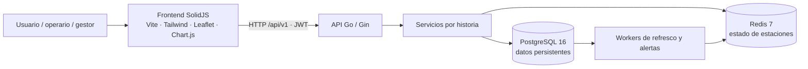
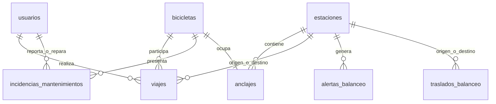

# Memoria del proyecto · SI-16 Bicicletas Compartidas

**Asignatura:** Ingeniería Web · Práctica de desarrollo dirigido por especificaciones (SSD)  
**Equipo:** Iker Roig, Alex Morell, Josep Peiró y Alberto Copa  
**Versión examinada:** `main` local, cierre funcional `26931de` más documentación y entregables finales · 21 de noviembre de 2026  
**Repositorio GitHub:** <https://github.com/ikerroig/iw-bicibletas-compartidas>

## Portada y resumen

SI-16 es una aplicación web para usuarios y personal de un servicio público de bicicletas compartidas en València. Permite consultar la disponibilidad de estaciones, alquilar y devolver bicicletas, revisar viajes, notificar y resolver averías, equilibrar la flota y analizar su uso. El resultado es un monorepositorio con frontend SolidJS, API Go, PostgreSQL para los datos persistentes y Redis para el estado en vivo, desarrollado en ocho historias mediante especificaciones, tareas, pruebas y revisiones cruzadas. La [demo audiovisual](../DemoSSD_GXX/index.html) muestra la aplicación real conectada al backend y registra recorridos, validaciones, permisos y cambios de estado.

## 1. Introducción

### Contexto, problema y objetivos

Una red de unas 60 estaciones necesita ofrecer datos útiles para planificar un trayecto y evitar operaciones incompatibles: alquilar con el abono vencido, mantener dos viajes abiertos o volver a poner en circulación una bicicleta averiada. Al mismo tiempo, taller, logística y gestión municipal necesitan información coherente sobre la misma flota. El objetivo del proyecto es resolver esos flujos con una fuente de datos compartida, autorización por rol, reglas de negocio verificadas en el servidor y una interfaz que informe de los resultados y errores.

La fuente funcional inicial es [historia.md](../historia.md). La [constitución](../.specify/memory/constitution.md) fija la pila, el modelo único, la autoridad del backend sobre las reglas críticas, la frescura de los datos de estaciones y la revisión de cada rama mediante PR. Cada historia tiene su carpeta de especificación en [specs/](../specs/).

## 2. Análisis

### Historias, actores y requisitos

| Historia | Actor principal | Resultado funcional | Responsable |
|---|---|---|---|
| [HU-01](../specs/spec-001/spec.md) | Usuario registrado | Mapa y lista de estaciones con detalle y disponibilidad reciente | Iker Roig |
| [HU-02](../specs/spec-002/spec.md) | Usuario con abono vigente | Desbloqueo por código de anclaje y apertura de un único viaje | Iker Roig |
| [HU-03](../specs/spec-003/spec.md) | Usuario en viaje | Devolución en anclaje libre y cálculo de la tarifa | Alex Morell |
| [HU-04](../specs/spec-004/spec.md) | Usuario del servicio | Historial propio, filtro mes/año, importe y tramo gratuito | Alex Morell |
| [HU-05](../specs/spec-005/spec.md) | Usuario que detecta una avería | Reporte e inhabilitación de la bicicleta; incidencia pendiente | Josep Peiró |
| [HU-06](../specs/spec-006/spec.md) | Operario de taller | Consulta del reporte, parte de reparación e incorporación posterior a una estación | Josep Peiró |
| [HU-07](../specs/spec-007/spec.md) | Operario de logística | Alertas de estaciones desequilibradas y traslados de bicicletas | Alberto Copa |
| [HU-08](../specs/spec-008/spec.md) | Gestor municipal | Gráficos por hora y día de la semana y exportación CSV | Alberto Copa |

Los cuatro roles persistidos son `usuario`, `operario_taller`, `operario_logistica` y `gestor`. El backend autentica las peticiones y controla los permisos; el menú del frontend muestra las áreas pertinentes a cada rol. La consulta del historial se limita a los viajes del usuario autenticado, mientras que la analítica utiliza los viajes finalizados de toda la red.

Los requisitos funcionales más relevantes atraviesan varias historias: el abono debe estar vigente para desbloquear; solo puede haber un viaje activo por usuario; los primeros 30 minutos son gratuitos; una bicicleta averiada no se alquila ni suma como disponible; una reparación sin anclaje confirmado tampoco suma; las alertas se activan con ocupaciones **< 10 %** o **> 90 %** y el gestor puede exportar los viajes del mismo rango mostrado en los gráficos. Estos criterios están detallados en los `spec.md`, el [contrato OpenAPI](../specs/spec-001/contracts/openapi.yaml) y el [modelo común](../specs/spec-001/data-model.md).

Entre los requisitos no funcionales figuran la actualización de disponibilidad en un máximo de **30 s** (HU-01), la devolución y el desbloqueo válidos en menos de **10 s** (HU-02/03), el historial con respuesta objetivo inferior a **3 s** (HU-04) y los gráficos de hasta un año en menos de **5 s** (HU-08). Son objetivos de las specs; su comprobación depende de las condiciones de medida indicadas en cada quickstart. La medición [S1e con perfil «Fast 4G»](../specs/spec-001/refinamiento/verificacion-final.md) registró marcadores en ≤ 0,85 s en producción y ≤ 4,02 s en desarrollo, y detalle en ≤ 73 ms.

## 3. Diseño

### Arquitectura

El repositorio **no** adopta literalmente carpetas `apps/` y `packages/`: la separación real acordada está en `backend/` y `frontend/`. Los artefactos comunes son el esquema SQL, el contrato OpenAPI, el estado Redis y los modelos, no un paquete independiente.



El router común registra una función por spec ([`routes/register.go`](../backend/internal/routes/register.go)). En el frontend, [`routes.tsx`](../frontend/src/routes.tsx) y el [layout](../frontend/src/components/Layout.tsx) agrupan las páginas y la navegación. Los handlers atienden HTTP, los servicios aplican reglas y transacciones, y los hooks y workers recalculan el estado tras las mutaciones.

### Modelo de datos



PostgreSQL conserva usuarios y roles, estaciones, bicicletas, anclajes, viajes, incidencias de mantenimiento, alertas y traslados. La [migración base](../backend/migrations/0001_esquema_base.sql) crea las entidades y restricciones; las [migraciones posteriores](../backend/migrations/) incorporan campos de incidencia, mantenimiento preventivo, traslados e índices de urgencia. El índice único de viaje activo por usuario y la relación única bicicleta–anclaje ayudan a preservar invariantes incluso con peticiones concurrentes. El [modelo de datos](../specs/spec-001/data-model.md) describe campos, estados y transiciones.

Redis guarda el HASH `estacion:{id}:estado` con bicicletas disponibles, anclajes libres, porcentaje de ocupación y marca temporal; su TTL es de 120 s. Los cambios se publican después del commit y un worker repasa la red cada 10 s. Si falta el dato en Redis, la API lo reconstruye desde PostgreSQL. Se eligió este diseño para servir el mapa con rapidez sin convertir la caché en fuente definitiva de verdad. Una bicicleta averiada ocupa físicamente un anclaje, pero no suma como disponible.

### Decisiones técnicas

- Las reglas críticas se validan en Go: la interfaz facilita la operación, pero no decide si un alquiler, devolución, reporte o traslado es válido.
- El desbloqueo, la devolución, el reporte y los movimientos de flota usan transacciones para evitar estados parciales; se recalculan las estaciones afectadas tras confirmar el cambio.
- La tarifa tiene 30 minutos incluidos y cobra el exceso según `TARIFA_MINUTO`; el redondeo y los casos límite se documentan en [HU-03](../specs/spec-003/research.md).
- La disponibilidad y las alertas comparten la misma definición de bicicleta operativa anclada; así, una reparación aún sin ubicación no altera artificialmente los contadores.
- La analítica usa un filtro temporal común para agregados y CSV; la zona horaria funcional es `Europe/Madrid`, aunque las fechas se almacenan con zona en PostgreSQL.
- El contrato REST común está en OpenAPI; las specs añaden contratos particulares. Los cambios del esquema o del contrato compartido requieren coordinación del equipo según la constitución.

## 4. Implementación

La pila es **Go 1.26 + Gin + pgx + goose + go-redis** en el backend; **SolidJS + TypeScript + Vite + Tailwind CSS**, con Leaflet y Chart.js, en el frontend. Docker Compose aporta PostgreSQL 16 y Redis 7. La autenticación utiliza JWT y contraseñas con hash. Las dependencias precisas están en [go.mod](../backend/go.mod) y [package.json](../frontend/package.json).

| Ubicación | Función |
|---|---|
| [`backend/cmd/`](../backend/cmd/) | Servidor, migraciones y seed reproducible |
| [`backend/internal/services/`](../backend/internal/services/) | Reglas de alquiler, devolución, viajes, incidencias, taller, balanceo y analítica |
| [`backend/internal/routes/`](../backend/internal/routes/) y [`handlers/`](../backend/internal/handlers/) | Registro por spec, autorización y endpoints |
| [`backend/internal/hooks/`](../backend/internal/hooks/) y [`workers/`](../backend/internal/workers/) | Recalcular estaciones, barrido de estado y alertas |
| [`frontend/src/pages/`](../frontend/src/pages/) | Pantallas por historia |
| [`frontend/src/services/api/`](../frontend/src/services/api/) y [`stores/`](../frontend/src/stores/) | Cliente de API, sesión y estado de la red |
| [`specs/`](../specs/) y [`docs/`](./) | Especificaciones, decisiones, tareas, trazabilidad y documentación final |

La primera implementación se integró desde ramas `spec-001` a `spec-008`. El refinamiento posterior aclaró comportamientos que no estaban suficientemente explicitados y ajustó código o pruebas: tratamiento de sesión y carga inicial en el mapa; orden de causas y resultado incierto al desbloquear; validación de devolución; filtro y paginación de historial; comprobación de estación en averías; mantenimiento preventivo; orden de urgencia de alertas; y formato/consistencia del CSV. Las specs 001–004 y 007–008 conservan informes separados en `refinamiento/`; las specs 005 y 006 registran ajustes y verificaciones en sus `spec.md`, `research.md`, `plan.md`, `tasks.md` y `quickstart.md`, sin una carpeta de informes equivalente.

Durante la grabación funcional final se detectó que la descarga CSV buscaba el
JWT en la clave antigua `token`, mientras que el store común lo guarda en
`si16.token`. T021 de HU-08 corrige el cliente para usar la clave compartida
y conserva la anterior como compatibilidad; la prueba de página usa ahora la
misma clave que una sesión real. La repetición de la demo confirmó que los
gráficos permanecen visibles y la exportación ya no devuelve `401`.

## 5. Pruebas y validación

### Estrategia y resultados actuales

Se combinan pruebas unitarias de reglas puras, pruebas de integración Go con PostgreSQL y Redis de test, comprobaciones de contrato OpenAPI, pruebas de componentes SolidJS con Vitest/Testing Library/MSW y recorridos manuales recogidos en los `quickstart.md`. La captura final usa [`record_demo.mjs`](../DemoSSD_GXX/record_demo.mjs) para conducir Edge mediante CDP y registrar la interfaz real; es un recorrido reproducible de demostración, aunque no sustituye una suite E2E con aserciones.

En el `main` local examinado, el **21-11-2026**, con PostgreSQL de pruebas publicado en `127.0.0.1:5433` y Redis en `6379`:

| Comprobación | Resultado |
|---|---|
| `go test -p 1 ./...` | Pasa todos los paquetes, incluidos `backend/tests`, contrato e integración; varios paquetes usaron caché de Go |
| `go vet ./...` | Sin avisos |
| `npm test -- --run --reporter=dot` | **16 archivos, 98 pruebas superadas** |
| `npm run build` | TypeScript y compilación de Vite correctos |

La primera ejecución en el entorno restringido falló antes de iniciar las suites por permisos sobre el caché de Go y la lectura de `vitest.config.ts`/`vite.config.ts` por `esbuild`; al repetirlas con acceso a esos recursos finalizaron correctamente. `jsdom` imprimió avisos sobre `window.scrollTo` y navegación durante las pruebas, sin fallos de test.

Los casos reproducibles por historia están en los [quickstarts](../specs/spec-001/quickstart.md) y en las [evidencias de refinamiento](../specs/). Como ejemplos concretos: HU-01 registra el mapa, estados sin bicicletas y recuperación tras pérdida de conexión; HU-02 recoge rechazos por abono, viaje activo y anclaje inválido; HU-03 comprueba el límite de 30 minutos; HU-05/HU-06 documentan reporte, panel de incidencias, reparación y reubicación; HU-07 registra un traslado válido y otro sin capacidad; HU-08 compara agregados con CSV y prueba roles, rango vacío y entrada inválida.

### Acta de recorridos integrados

Los dos recorridos se ejecutaron el **21-11-2026** sobre `main`, incluida
T021 de HU-08 (commit `26931de`), con PostgreSQL en `127.0.0.1:5433`, Redis en
`6379`, API en `:8080` y frontend en `:5173`. El resultado observado está
conservado en la [grabación MP4](../DemoSSD_GXX/demo-si16.mp4).

| Recorrido | Precondiciones y datos | Pasos | Resultado esperado | Resultado observado |
|---|---|---|---|---|
| Satisfactorio, distintos responsables: HU-01 → HU-02 → HU-03 → HU-04 | `ana@si16.test`, abono vigente y sin viaje; `BICI-0002` en `E01-A02`; `E01-A08` libre | Consultar mapa/lista y detalle; desbloquear `E01-A02`; probar un código de devolución inexistente; devolver en `E01-A08`; abrir «Mis viajes» | Un viaje activo como máximo; el código inválido no altera datos; el válido finaliza y tarifica; el viaje aparece en el historial | El mapa y los contadores cargaron; el desbloqueo mostró `BICI-0002` en curso; el código inválido fue rechazado; `E01-A08` finalizó el viaje y el registro apareció primero en el historial con coste calculado |
| Estado/error, distintos responsables: HU-05 → HU-06 → HU-07 | `ana@si16.test`, `taller@si16.test`, `logistica@si16.test`; `BICI-0003` anclada en estación 1; estaciones 10 y 8 disponibles para balanceo | Reportar fallo de frenos; comprobar el panel; consultar ficha; guardar parte y confirmar `E01-A03`; abrir balanceo; intentar origen=destino; confirmar traslado válido 10→8 | La incidencia pasa a pendiente y luego resuelta; la bicicleta solo vuelve tras ubicarla; el traslado inválido no cambia la red; el válido recalcula ambas estaciones | El panel mostró el reporte; la ficha pasó de averiada/pendiente a intervención resuelta y ubicación confirmada; origen=destino mostró error; el traslado válido presentó «Traslado confirmado» y los nuevos contadores |

## 6. Despliegue y uso

### Arranque local

Requisitos: Docker Desktop con Compose v2, Go 1.26 o superior, Node.js 20 o superior y npm. El [README](../README.md) y [`.env.example`](../.env.example) son la guía operativa. En PowerShell, desde la raíz del repositorio:

```powershell
Copy-Item .env.example .env
# Revisar .env: JWT_SECRET, credenciales y, si procede, puertos de PostgreSQL.
docker compose up -d

cd backend
go run ./cmd/migrate up
go run ./cmd/seed
go run ./cmd/server
```

En otra terminal:

```powershell
cd frontend
npm install
npm run dev
```

La API escucha por defecto en `http://localhost:8080/api/v1` y la interfaz en `http://localhost:5173`. `docker compose` levanta **PostgreSQL y Redis**, no el servidor Go ni Vite. Si el puerto `5432` no está libre, se puede crear un `docker-compose.override.yml` local y ajustar `DATABASE_URL` y `TEST_DATABASE_URL`; en esta máquina se ha usado temporalmente `5433`. No publicar el `.env` con secretos ni ejecutar el seed sobre datos reales: reinicializa los datos de demostración.

### Manual breve por rol

- **Usuario:** iniciar sesión, consultar «Mapa» o la lista, abrir el detalle de estación, introducir el código del anclaje en «Desbloquear», usar «Devolver» con un anclaje libre, revisar «Mis viajes» y comunicar averías desde «Reportar avería».
- **Operario de taller:** entrar en «Incidencias», abrir la ficha en «Taller», registrar el parte y confirmar un anclaje antes de que la bicicleta vuelva a contar como disponible.
- **Operario de logística:** abrir «Balanceo», revisar la prioridad de las alertas y registrar el traslado entre estaciones.
- **Gestor:** abrir «Analítica», seleccionar el rango y descargar el CSV del mismo periodo.

El seed genera usuarios de demostración con contraseña `password`: `ana@si16.test` (`usuario`), `taller@si16.test` (`operario_taller`), `logistica@si16.test` (`operario_logistica`) y `gestor@si16.test` (`gestor`). Hay más perfiles y condiciones en el [README](../README.md). Estas credenciales son exclusivamente de prueba.

## 7. Planificación y seguimiento

El reparto de dos historias por integrante está en [agrupamiento.md](./agrupamiento.md). El proceso seguido fue: especificar historias y criterios; acordar constitución, modelo y contratos; planificar y desglosar tareas; implementar por rama; probar; aplicar `clarify → analyze → implement → converge`; revisar entre compañeros y fusionar por PR. Los registros de decisiones, informes inicial/final, hallazgos y convergencia permanecen junto a cada spec.

Las PR iniciales de HU-01 a HU-06 figuran en [agrupamiento.md](./agrupamiento.md). Entre las integraciones de refinamiento visibles en el historial local están [#8 (HU-01)](https://github.com/ikerroig/iw-bicibletas-compartidas/pull/8), [#9 (HU-02)](https://github.com/ikerroig/iw-bicibletas-compartidas/pull/9), [#11 (HU-03)](https://github.com/ikerroig/iw-bicibletas-compartidas/pull/11), [#12 (HU-04)](https://github.com/ikerroig/iw-bicibletas-compartidas/pull/12), [#15 (HU-05)](https://github.com/ikerroig/iw-bicibletas-compartidas/pull/15), [#16 (HU-06)](https://github.com/ikerroig/iw-bicibletas-compartidas/pull/16), [#14 (HU-07)](https://github.com/ikerroig/iw-bicibletas-compartidas/pull/14) y [#17 (HU-08)](https://github.com/ikerroig/iw-bicibletas-compartidas/pull/17). El historial se puede reconstruir con `git log --oneline --graph --all`; no se inventa aquí un número de issue cuando la evidencia local solo identifica una PR.

### Balance del refinamiento

| Indicador, con denominador | Estado en la versión examinada | Fuente |
|---|---|---|
| Historias con `spec.md`, `plan.md` y `tasks.md` | 8/8 | Carpetas [`spec-001` a `spec-008`](../specs/) |
| Historias con informes de refinamiento separados | 6/8; HU-05 y HU-06 documentan ajustes en sus archivos principales | Carpetas `refinamiento/` y [quickstarts](../specs/) |
| Historias desarrolladas en la matriz global | **8/8**, con FR/SC, tarea, prueba prevista y estado | [Matriz](./matriz-trazabilidad.md) |
| Recorridos integrados ejecutados | **2/2**, uno satisfactorio y otro con estado/error, entre responsables distintos | Sección 5 y [demo funcional](../DemoSSD_GXX/index.html) |
| Criterios HU-01 con tarea y prueba prevista | 21/21; incluidos los medidos con «Fast 4G» | [Verificación final](../specs/spec-001/refinamiento/verificacion-final.md) |
| Suites de la integración local | Backend completo, `go vet`, 98/98 pruebas frontend y build correctos | Ejecución del 21-11-2026, sección 5 |

Este balance informa del estado documental y técnico, no atribuye a todas las historias la misma profundidad de evidencia. Los informes de cada spec conservan las decisiones y hallazgos propios; no se ha sumado un recuento de hallazgos sin una base homogénea.

### Registro resumido de trazabilidad y revisión

La [matriz global](./matriz-trazabilidad.md) desarrolla los criterios de las
ocho historias. Esta tabla aporta el registro mínimo solicitado por el
enunciado con una muestra trazable por historia:

| Historia y criterio | Hallazgo o decisión | Comando utilizado | Documentos o código afectados | Tarea y commit | Prueba y resultado | Responsable | Revisor | Estado |
|---|---|---|---|---|---|---|---|---|
| HU-01, FR-003 | Polling y barrido Redis para ≤30 s | `npm test`; recorrido S1g | store/mapa, worker y verificación final | T025/T026/T029 · `1b8f033` | S1g: 15,8 s; tests pasan | Iker | Alex | Cerrado |
| HU-02, FR-002 | Validar abono y causa antes de desbloquear | `go test -p 1 ./...` | servicio de alquiler y verificación V1 | T044/T045 · `b69dc49` | Abono vencido rechazado con causa | Iker | Alex | Cerrado |
| HU-03, FR-003/004 | Cobrar únicamente el exceso de 30 min | `go test -p 1 ./...` | tarifa, tests y converge-2 | T028–T030 · `09a76a8` | Bordes 30:00/30:01 correctos | Alex | Iker | Cerrado |
| HU-04, FR-002 | Mes interpretado en Europe/Madrid | `go test -p 1 ./...`; `npm test` | historial, filtros y converge-2 | T4b/T4g · `39f7eb1` | Filtro y suma del periodo correctos | Alex | Iker | Cerrado |
| HU-05, FR-003/004 | Averiada no alquilable ni disponible | `go test ./tests -run 'TestAveria'` | servicio, contadores, quickstart y matriz | T004/T013/T018 · `be76c22` | Tres tests pasan; demo muestra reporte y panel | Josep | Alberto | Cerrado |
| HU-06, FR-005/007 | Separar reparación de ubicación | `go test ./tests -run 'TestTaller'` | servicio de taller, pantalla y quickstart | T006/T009/T017 · `1fd6ebc` | Tres tests pasan; demo confirma parte y anclaje | Josep | Alberto | Cerrado |
| HU-07, FR-005/007 | Orden de urgencia y recálculo post-commit | `go test -p 1 ./...`; escenario S7 | balanceo, worker, migraciones y matriz | T007/T011/T019 · `746366e` | T7a–T7h pasan; demo valida error y traslado | Alberto | Josep | Cerrado |
| HU-08, FR-003/005/006 | Filtro común y JWT compartido para CSV | `npm test -- --run src/pages/analitica/index.test.tsx`; demo | cliente CSV, test, T021 y matriz | T013/T017/T021 · revisión `832719a` · cierre `26931de` | 6/6 tests; gráficos, 403, CSV y rango inválido observados | Alberto | Josep | Cerrado |

## 8. Conclusiones y trabajo futuro

Se han implementado las ocho historias con una arquitectura y un modelo de datos comunes; los tests del estado local pasan y hay evidencia manual por spec. El ciclo de refinamiento permitió concretar permisos, estados y límites, y preservar los hallazgos y decisiones en el repositorio. Entre los problemas encontrados estuvieron la coordinación de contratos y migraciones compartidas, las condiciones de concurrencia en alquiler/devolución y diferencias del entorno Windows (puertos, caché Go y permisos de `esbuild`), que se trataron sin confundirlos con fallos funcionales.

La versión final reúne las ocho historias en la matriz global, registra dos
recorridos integrados y conserva una demo funcional de la interfaz. La medida
de HU-01 SC-004 con «Fast 4G» está en la evidencia S1e y la corrección final de
autenticación del CSV queda en T021. Como trabajo futuro se puede convertir el
recorrido de captura en una suite E2E con aserciones y automatizar el
despliegue. Antes de subir los ZIP solo debe sustituirse el marcador `GXX` por
el número real del grupo si la plataforma no acepta el nombre provisional.

## 9. Anexos

- [Repositorio GitHub](https://github.com/ikerroig/iw-bicibletas-compartidas), [reparto del equipo](./agrupamiento.md) y [matriz global](./matriz-trazabilidad.md).
- [Historias originales](../historia.md), [constitución](../.specify/memory/constitution.md), [plan y modelo comunes](../specs/spec-001/plan.md), [OpenAPI](../specs/spec-001/contracts/openapi.yaml) y [migraciones](../backend/migrations/).
- Especificaciones completas: [HU-01](../specs/spec-001/), [HU-02](../specs/spec-002/), [HU-03](../specs/spec-003/), [HU-04](../specs/spec-004/), [HU-05](../specs/spec-005/), [HU-06](../specs/spec-006/), [HU-07](../specs/spec-007/) y [HU-08](../specs/spec-008/).
- [Vídeo, reproductor e instrucciones de la demo](../DemoSSD_GXX/README.md).

### Glosario

| Término | Significado en SI-16 |
|---|---|
| Anclaje | Punto físico de una estación donde se fija o libera una bicicleta mediante código. |
| Abono vigente | Abono activo cuya fecha de vencimiento no ha pasado en `Europe/Madrid`. |
| Viaje activo | Trayecto iniciado por desbloqueo y todavía no finalizado por devolución. |
| Incidencia | Reporte de avería y seguimiento de la intervención técnica de una bicicleta. |
| Estado en vivo | Contadores de estación calculados desde los datos persistentes y publicados en Redis con marca temporal. |
| Balanceo | Detección de estaciones desequilibradas y traslado de bicicletas entre ellas. |
| SSD / Spec Kit | Desarrollo guiado por especificación, plan, tareas, implementación y refinamiento verificable. |
| PR | Pull Request: propuesta de integración revisada por otro miembro del equipo. |
