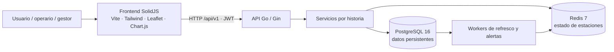
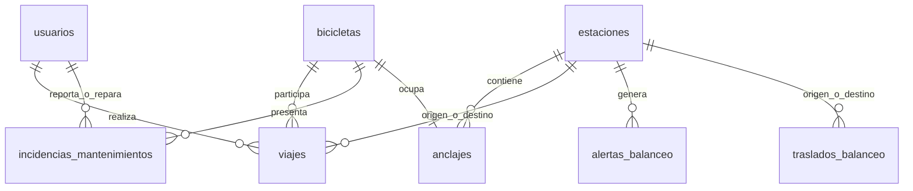

# Memoria del proyecto: SI-16 Bicicletas Compartidas

**Aplicación web para el servicio público de bicicletas compartidas de una ciudad mediana**

Asignatura: Ingeniería Web · Práctica de desarrollo dirigido por especificaciones (SDD) · Grupo 13
Equipo: Iker Roig, Alex Morell, Josep Peiró y Alberto Copa
Fecha de la memoria: 25 de noviembre de 2026 · Estado del código: rama `main`, commit `9d04ced`

---

## Índice

1. [Portada y resumen](#1-portada-y-resumen)
2. [URL del repositorio en GITHUB](#2-url-del-repositorio-en-github)
3. [Introducción](#3-introducción)
4. [Análisis](#4-análisis)
5. [Diseño](#5-diseño)
6. [Implementación](#6-implementación)
7. [Pruebas y validación](#7-pruebas-y-validación)
8. [Despliegue y uso](#8-despliegue-y-uso)
9. [Planificación y seguimiento](#9-planificación-y-seguimiento)
10. [Conclusiones](#10-conclusiones)
11. [Demo](#11-demo)
12. [Anexos](#12-anexos)

---

## 1. Portada y resumen

**SI-16** es una aplicación web para el servicio municipal de bicicletas compartidas de una ciudad mediana: unas 60 estaciones de 10 a 20 anclajes y algo más de 600 bicicletas. Cubre el ciclo completo de un viaje y la operación del servicio: consulta de la disponibilidad en un mapa casi en tiempo real, desbloqueo por código de anclaje, devolución con cálculo de la tarifa, historial de viajes, reporte de averías, partes de taller, alertas y traslados para equilibrar la flota, y analítica de uso exportable a CSV.

**Para quién.** Tiene cuatro roles con permisos distintos:

- **Usuario** con abono anual: consulta el mapa, alquila y devuelve bicicletas, revisa sus viajes y reporta averías, también desde el móvil.
- **Operario de taller**: atiende las incidencias, registra las reparaciones y devuelve la bicicleta a un anclaje.
- **Operario de logística**: recibe las alertas de estaciones vacías o llenas y registra los traslados.
- **Gestor** del servicio: consulta las estadísticas de uso y exporta los datos.

**Resultado.** Las ocho historias de usuario (HU-01 a HU-08, una spec por historia) están implementadas en un monorepositorio con frontend SolidJS + Tailwind CSS, API en Go con Gin, PostgreSQL como base de datos principal y Redis para el estado en vivo de las estaciones, que es la pila propuesta en el pliego. Pasan las suites automáticas de backend (unitarias, contrato e integración) y de frontend (véase [§7.2](#72-resultados-de-las-pruebas-automáticas)). El refinamiento con `clarify`, `analyze` y `converge` dejó 0 brechas funcionales y ninguna incidencia crítica o alta abierta; solo se conserva una nota documental de coordinación de HU-04 (véase [§9.4](#94-balance-del-refinamiento)). La [demo](#11-demo) recorre las ocho historias en 101 escenarios grabados sobre la aplicación real.

El proyecto se ha desarrollado con **GitHub Spec Kit**: cada historia nace de un `spec.md` y pasa por `clarify`, `plan`, `tasks`, `analyze`, `implement` y `converge`. Esta memoria se apoya en esos documentos, que se conservan en [`specs/`](../specs/).

---

## 2. URL del repositorio en GITHUB

El código fuente está publicado en GitHub: <https://github.com/ikerroig/iw-bicibletas-compartidas>

---

## 3. Introducción

### 3.1 Contexto

El ayuntamiento quiere sustituir un sistema obsoleto que genera muchas reclamaciones. El nuevo sistema debe dar servicio a tres colectivos que trabajan sobre la misma flota: los usuarios, que necesitan saber dónde hay bicicletas y anclajes libres; los operarios de calle y de taller, que mueven y reparan las bicicletas; y el gestor, que responde ante el ayuntamiento y decide dónde ampliar la red. La fuente funcional es la descripción narrativa del sistema SI-16 proporcionada con el enunciado; las ocho historias que el equipo extrajo de ella, con su reparto, están en [historia.md](../historia.md).

### 3.2 Problema que resuelve

- **Información poco fiable**: el usuario debe ver bicicletas y anclajes libres con un retraso máximo de 30 s respecto a lo que pasa en la estación.
- **Operaciones incompatibles**: alquilar con el abono vencido, tener dos viajes abiertos a la vez o volver a poner en circulación una bicicleta averiada.
- **Cargos que el usuario no entiende**: los primeros 30 minutos están incluidos en el abono y solo se cobra el exceso; el historial debe permitir comprobar cada importe.
- **Flota desequilibrada**: por la mañana se vacían los barrios y se llena el centro, y por la tarde al revés; los operarios necesitan prioridades claras.
- **Decisiones sin datos**: el gestor necesita estadísticas por franja horaria y por día de la semana, y poder trabajarlas en otras herramientas.

### 3.3 Objetivos

1. Ofrecer a cada rol las pantallas que necesita, con una única fuente de datos compartida.
2. Validar en el servidor todas las reglas críticas: abono vigente, viaje único, tramo gratuito, bicicleta averiada no alquilable, umbrales de balanceo y permisos por rol.
3. Mantener la disponibilidad de las estaciones con frescura de 30 s como máximo.
4. Seguir el ciclo SDD completo en las ocho historias, con responsabilidad individual trazable y refinamiento documentado.

### 3.4 Constitución del proyecto

La [constitución](../.specify/memory/constitution.md) (versión 1.0.1, ratificada el 20-10-2026) fija cinco principios:

| Principio | Qué exige |
|---|---|
| I. Autoridad del backend en las reglas de negocio (no negociable) | Las reglas críticas se validan en Go; el frontend solo facilita la operación. |
| II. Pila tecnológica acordada | SolidJS + Tailwind CSS, Go + Gin, PostgreSQL y Redis, como propone el pliego. |
| III. Arquitectura separada con modelo de datos compartido | `backend/` y `frontend/` separados; un único esquema, contrato OpenAPI y modelos comunes; los cambios compartidos se acuerdan en equipo. |
| IV. Disponibilidad en tiempo real con frescura ≤ 30 s | El estado en vivo se publica en Redis y el cliente se refresca dentro del límite. |
| V. Independencia por especificación | Cada historia tiene su spec, su rama y su registro de rutas, para trabajar en paralelo sin pisarse. |

Además fija los acuerdos de colaboración: una rama por spec (`spec-001` a `spec-008`), integración solo mediante Pull Request revisada por otro integrante, puerta de calidad con pruebas automáticas de las reglas críticas y coordinación previa de cualquier cambio de esquema.

---

## 4. Análisis

### 4.1 Actores y roles

| Actor | Rol en el sistema | Qué puede hacer |
|---|---|---|
| Usuario | `usuario` | Consultar el mapa y el detalle de estaciones (HU-01), desbloquear con abono vigente (HU-02), devolver (HU-03), ver su historial (HU-04) y reportar averías (HU-05). |
| Operario de taller | `operario_taller` | Ver las incidencias pendientes (HU-05), registrar partes de reparación y confirmar la ubicación de la bicicleta reparada (HU-06). |
| Operario de logística | `operario_logistica` | Consultar las alertas de balanceo ordenadas por urgencia y registrar traslados (HU-07). |
| Gestor | `gestor` | Consultar la analítica de uso y exportar el CSV (HU-08). |
| Sistema | Workers | Recalculan el estado de las estaciones cada 10 s y tras cada cambio, y generan o resuelven las alertas de balanceo. |

La narrativa habla de «operarios de calle» que también retiran las bicicletas averiadas. El equipo separó taller y logística en dos roles porque sus pantallas y datos no se solapan; los dos son personal del servicio y ninguno puede alquilar.

### 4.2 Historias de usuario

El enunciado de cada historia procede de [historia.md](../historia.md) y de la sección de historia de su `spec.md`.

| Spec | Historia | Responsable |
|---|---|---|
| [spec-001](../specs/spec-001/spec.md) | HU-01. Como **usuario con abono**, quiero ver un mapa con todas las estaciones y el estado en vivo de bicicletas y anclajes, para planificar dónde recoger y dónde dejar la bicicleta. | Iker Roig |
| [spec-002](../specs/spec-002/spec.md) | HU-02. Como **usuario con abono en regla**, quiero introducir el código del anclaje, para desbloquear la bicicleta e iniciar el trayecto. | Iker Roig |
| [spec-003](../specs/spec-003/spec.md) | HU-03. Como **usuario en viaje**, quiero fijar la bicicleta en un anclaje libre de cualquier estación, para finalizar el viaje y que se aplique la tarifa. | Alex Morell |
| [spec-004](../specs/spec-004/spec.md) | HU-04. Como **usuario del servicio**, quiero consultar mi historial y filtrarlo por mes y año, para verificar los importes y controlar el gasto. | Alex Morell |
| [spec-005](../specs/spec-005/spec.md) | HU-05. Como **usuario que detecta una avería**, quiero notificarla desde la aplicación, para que nadie más alquile la bicicleta y el taller lo sepa. | Josep Peiró |
| [spec-006](../specs/spec-006/spec.md) | HU-06. Como **operario de taller**, quiero registrar los partes de reparación (avería, piezas y técnico), para conservar el historial de cada unidad y reactivar solo las bicicletas reparadas. | Josep Peiró |
| [spec-007](../specs/spec-007/spec.md) | HU-07. Como **operario de logística**, quiero recibir alertas de estaciones por debajo del 10 % o por encima del 90 % de ocupación ordenadas por urgencia, para planificar los traslados. | Alberto Copa |
| [spec-008](../specs/spec-008/spec.md) | HU-08. Como **gestor municipal**, quiero analizar el uso con gráficos por franja horaria y día de la semana y exportarlo a CSV, para justificar ampliaciones ante el ayuntamiento. | Alberto Copa |

El reparto de dos historias por integrante está en [agrupamiento.md](./agrupamiento.md).

### 4.3 Requisitos funcionales

Cada spec numera sus requisitos como `FR-nnn` y sus criterios de éxito como `SC-nnn` (73 FR y 36 SC en total). Se resumen por historia; el texto íntegro está en cada `spec.md`.

**Valores de negocio compartidos**

| Valor | Cifra |
|---|---|
| Frescura máxima de la disponibilidad | 30 s, de extremo a extremo |
| Tramo incluido en el abono | 30 minutos por viaje |
| Tarifa del excedente | `TARIFA_MINUTO` (0,20 € por minuto en la demo) |
| Umbrales de alerta de balanceo | ocupación < 10 % o > 90 % |
| Zona horaria funcional | `Europe/Madrid` |
| Viajes activos por usuario | 1 |

**Por historia**

| Spec | Requisitos clave |
|---|---|
| 001 Disponibilidad (13 FR, 8 SC) | Mapa con todas las estaciones y contadores de bicicletas disponibles y anclajes libres; reflejar cualquier cambio en ≤ 30 s; detalle que se actualiza solo; las averiadas no cuentan; hora de la última actualización y aviso de datos desactualizados; estados propios para «sin bicicletas», «sin anclajes» y «fuera de servicio»; listado textual accesible; error claro si falla la primera carga; acceso solo con sesión. |
| 002 Desbloqueo (12 FR, 4 SC) | Código de anclaje normalizado; abono vigente; ningún viaje activo; anclaje existente, en servicio y con bicicleta disponible; alta atómica del viaje con hora de inicio; solo el rol `usuario`; aviso del abono al abrir la pantalla; resultado incierto ante falta de respuesta o error 5xx; una sola causa de rechazo en orden fijo. |
| 003 Devolución (9 FR, 4 SC) | Cerrar el viaje en un anclaje libre de cualquier estación; coste 0 hasta 30 min y exceso redondeado al minuto; cierre único aunque lleguen dos peticiones; rechazo sin viaje activo o con anclaje ocupado o inexistente; solo el propietario; se permite devolver con el abono ya caducado. |
| 004 Historial (8 FR, 4 SC) | Lista cronológica de los viajes finalizados propios con origen, destino, duración e importe; filtro por mes y año en `Europe/Madrid`; sumatorio del periodo; etiqueta del tramo gratuito; paginación en el servidor. |
| 005 Averías (8 FR, 4 SC) | Reporte con descripción; la bicicleta pasa a «Averiada», no se alquila y deja de contar en mapas y listas; incidencia pendiente visible para el taller; sin transiciones duplicadas; la estación debe ser la real de la bicicleta. |
| 006 Taller (7 FR, 4 SC) | Ficha con la incidencia y el historial; parte con fecha, operario, avería y piezas sustituidas; reparar y ubicar son pasos separados; la bicicleta solo vuelve a contar como disponible al confirmar el anclaje; la incidencia se resuelve al repararla. |
| 007 Balanceo (9 FR, 4 SC) | Porcentaje de ocupación por estación; alerta automática al cruzar los umbrales, única por estación y resuelta sola al normalizarse; panel ordenado por urgencia; traslados validados (origen ≠ destino, lote disponible, capacidad en destino) con recálculo inmediato; solo logística. |
| 008 Analítica (7 FR, 4 SC) | Filtro por rango de fechas; gráficos de viajes por hora del día y por día de la semana; CSV del mismo rango en UTF-8 con BOM, RFC 4180 y CRLF; gráficos y CSV coherentes; solo el gestor. En el `clarify` del 20-11-2026 el equipo decidió no añadir un desglose por estación, para no ampliar el contrato compartido ([registro](../specs/spec-008/refinamiento/clarify.md)). |

### 4.4 Requisitos no funcionales

| Ámbito | Requisito | Fuente |
|---|---|---|
| Frescura | Cualquier cambio de disponibilidad visible en ≤ 30 s (peor caso medido ≈ 28 s). | 001 FR-003, SC-002 |
| Rendimiento | Mapa completo en menos de 5 s con 4G (medido ≤ 0,85 s en producción); desbloqueo y devolución en menos de 10 s; historial en menos de 3 s; gráficos de un año en menos de 5 s. | 001 SC-004, 002 SC-003, 003 SC-003, 004 SC-004, plan de 008 |
| Fiabilidad | Un solo viaje activo por usuario y un solo cierre por viaje, también con peticiones concurrentes; ninguna bicicleta en estado inconsistente. | 002 FR-007, 003 FR-006, 005 SC-004, 006 SC-004 |
| Seguridad | Autenticación JWT; contraseñas con hash; permisos comprobados en el servidor en cada endpoint; secretos solo en `.env`. | Constitución I, contrato OpenAPI |
| Accesibilidad | Estados que no dependen solo del color; listado textual alternativo al mapa; mensajes de error explícitos. | 001 FR-008, FR-011 |
| Interoperabilidad | CSV que se abre sin perder tildes ni eñes en hojas de cálculo. | 008 FR-004, SC-004 |
| Idioma y formato | Español de España; euros; fechas `dd/mm/aaaa`; zona horaria `Europe/Madrid`. | Specs 002, 004 y 008 |
| Uso móvil | Interfaz ligera y adaptable, pensada para consultarse en la calle. | Pliego, constitución II |

### 4.5 Reglas que cruzan historias

La parte más delicada del análisis es qué ocurre cuando una historia afecta a otra. Las reglas se aplican en el servidor y comparten una única definición de **bicicleta operativa anclada**, que es lo que cuentan el mapa (HU-01), el desbloqueo (HU-02) y las alertas (HU-07):

1. **HU-02** abre el viaje y libera el anclaje; **HU-03** lo cierra en otro anclaje y calcula el importe; **HU-04** solo muestra los viajes ya finalizados, con el mismo coste.
2. **HU-05** marca la bicicleta como averiada: deja de contar como disponible en **HU-01** y **HU-07** aunque siga ocupando físicamente el anclaje, y **HU-02** la rechaza.
3. **HU-06** repara la bicicleta, pero hasta que no confirma el anclaje no vuelve a sumar en **HU-01** ni en **HU-07**.
4. Cada mutación (desbloqueo, devolución, reporte, ubicación o traslado) recalcula después del commit las estaciones afectadas en Redis, y con ellas las alertas de **HU-07**.
5. **HU-08** solo analiza los viajes finalizados de **HU-03**, con el mismo filtro temporal para los gráficos y el CSV.

---

## 5. Diseño

### 5.1 Arquitectura

El repositorio **no** usa carpetas `apps/` y `packages/`: la separación acordada en la constitución (principio III) es `backend/` y `frontend/`. Los artefactos comunes son el esquema SQL, el contrato OpenAPI, el estado en Redis y los modelos, no un paquete independiente.



El router común registra una función por spec ([`routes/register.go`](../backend/internal/routes/register.go)). En el frontend, [`routes.tsx`](../frontend/src/routes.tsx) y el [layout](../frontend/src/components/Layout.tsx) agrupan las páginas y el menú por rol. Los handlers atienden HTTP, los servicios aplican reglas y transacciones, y los hooks y workers recalculan el estado tras las mutaciones.

### 5.2 Modelo de datos



PostgreSQL conserva usuarios y roles, estaciones, bicicletas, anclajes, viajes, incidencias de mantenimiento, alertas y traslados. La [migración base](../backend/migrations/0001_esquema_base.sql) crea las entidades y restricciones; las [migraciones posteriores](../backend/migrations/) añaden campos de incidencia, mantenimiento, traslados e índices de urgencia. El índice único de viaje activo por usuario y la relación única bicicleta–anclaje protegen los invariantes incluso con peticiones concurrentes. El [modelo de datos](../specs/spec-001/data-model.md) describe campos, estados y transiciones.

Redis guarda el HASH `estacion:{id}:estado` con bicicletas disponibles, anclajes libres, porcentaje de ocupación y marca temporal, con un TTL de 120 s. Los cambios se publican después del commit y un worker repasa la red cada 10 s. Si falta el dato en Redis, la API lo reconstruye desde PostgreSQL. Se eligió este diseño para servir el mapa con rapidez sin convertir la caché en la fuente de verdad. Una bicicleta averiada ocupa físicamente un anclaje, pero no suma como disponible.

### 5.3 Contrato de la API

El contrato REST común está en [OpenAPI](../specs/spec-001/contracts/openapi.yaml), con base `/api/v1`, autenticación por JWT en la cabecera `Authorization` y errores con un formato común (`error.codigo` y `error.mensaje`). Cada spec detalla sus endpoints en su carpeta `contracts/`.

| Método | Ruta | Historia | Rol |
|---|---|---|---|
| POST | `/auth/login` | Base común | Público |
| GET | `/auth/me` | Base común | Autenticado |
| GET | `/estaciones` · `/estaciones/{id}` | HU-01 | Autenticado |
| POST | `/alquileres/desbloqueo` | HU-02 | `usuario` |
| GET | `/alquileres/activo` | HU-02 | `usuario` |
| POST | `/devoluciones` | HU-03 | `usuario` (propietario) |
| GET | `/viajes` | HU-04 | Autenticado (solo sus viajes) |
| POST | `/incidencias` | HU-05 | `usuario` |
| GET | `/incidencias` | HU-05 | `operario_taller` |
| GET | `/taller/bicicletas/{id}` | HU-06 | `operario_taller` |
| POST | `/taller/bicicletas/{id}/intervenciones` · `/ubicacion` | HU-06 | `operario_taller` |
| GET | `/balanceo/alertas` | HU-07 | `operario_logistica` |
| POST | `/balanceo/traslados` | HU-07 | `operario_logistica` |
| GET | `/analitica/viajes` · `/analitica/export` | HU-08 | `gestor` |

Códigos habituales: `401` sin sesión, `403` rol no permitido, `404` recurso inexistente, `409` estado incompatible (por ejemplo, viaje ya activo o anclaje ocupado) y `422` entrada inválida.

### 5.4 Decisiones técnicas y por qué se tomaron

- **Las reglas críticas se validan en Go.** La interfaz facilita la operación, pero no decide si un alquiler, una devolución, un reporte o un traslado es válido (constitución I).
- **Transacciones en todas las mutaciones.** Desbloqueo, devolución, reporte y movimientos de flota se hacen en una transacción para evitar estados parciales, y las estaciones afectadas se recalculan tras el commit.
- **Redis como caché de lectura, no como fuente de verdad.** Permite servir el mapa rápido y cumplir los 30 s; si falta el dato, se reconstruye desde PostgreSQL.
- **Una sola definición de bicicleta operativa anclada** para disponibilidad y alertas, de modo que una reparación aún sin ubicar no altera los contadores.
- **Tarifa con 30 minutos incluidos** y exceso según `TARIFA_MINUTO`; el redondeo y los casos límite están en el [research de HU-03](../specs/spec-003/research.md).
- **Zona horaria funcional `Europe/Madrid`** para el abono, el historial y la analítica, aunque las fechas se guardan con zona en PostgreSQL.
- **Filtro temporal común** para los gráficos y el CSV de HU-08, para que nunca den cifras distintas.
- **Contrato compartido bajo control del equipo.** Los cambios en OpenAPI, esquema o modelos comunes se acuerdan antes de aplicarlos (constitución III); por eso, por ejemplo, HU-02 expone la fecha de vencimiento del abono desde sus propios endpoints en lugar de cambiar el modelo `Usuario`.

---

## 6. Implementación

### 6.1 Pila tecnológica

| Capa | Tecnología |
|---|---|
| Frontend | SolidJS + TypeScript + Vite, Tailwind CSS, Leaflet (mapa) y Chart.js (gráficos) |
| Backend | Go 1.26 + Gin, pgx, goose (migraciones), go-redis |
| Datos | PostgreSQL 16 y Redis 7, levantados con Docker Compose |
| Autenticación | JWT y contraseñas con hash |
| Pruebas | `go test` (unitarias, contrato e integración), Vitest + Testing Library + MSW |

Las versiones exactas están en [go.mod](../backend/go.mod) y [package.json](../frontend/package.json).

### 6.2 Estructura del repositorio

```text
iw-bicibletas-compartidas/
├── backend/
│   ├── cmd/            # server, migrate y seed reproducible
│   ├── internal/       # handlers, services, routes, hooks, workers, models, auth, cache...
│   ├── migrations/     # esquema SQL versionado (goose)
│   └── tests/          # pruebas de historia, contrato e integración
├── frontend/
│   ├── src/            # pages por historia, components, services/api, stores
│   └── tests/
├── specs/              # spec-001 … spec-008 (spec, plan, tasks, contratos, refinamiento)
├── .specify/           # constitución y plantillas de Spec Kit
├── docs/               # agrupamiento, memoria y matriz de trazabilidad
├── DemoSSD_G13/        # vídeos y reproductor de la demo
├── historia.md         # historias de usuario y reparto
└── docker-compose.yml  # PostgreSQL y Redis
```

### 6.3 Partes más relevantes del código

| Ubicación | Función |
|---|---|
| [`backend/internal/services/`](../backend/internal/services/) | Reglas de alquiler, devolución, viajes, incidencias, taller, balanceo y analítica |
| [`backend/internal/routes/`](../backend/internal/routes/) y [`handlers/`](../backend/internal/handlers/) | Registro por spec, autorización por rol y endpoints |
| [`backend/internal/hooks/`](../backend/internal/hooks/) y [`workers/`](../backend/internal/workers/) | Recálculo de estaciones tras cada commit, barrido periódico y alertas |
| [`backend/cmd/seed`](../backend/cmd/) | Datos de demostración: 60 estaciones, flota, usuarios de cada rol, viajes y estaciones al 5 % y al 95 % |
| [`frontend/src/pages/`](../frontend/src/pages/) | Pantallas por historia |
| [`frontend/src/services/api/`](../frontend/src/services/api/) y [`stores/`](../frontend/src/stores/) | Cliente de la API, sesión y estado de la red con refresco periódico |

### 6.4 Decisiones tomadas sobre la marcha

- **Integración de las ocho ramas.** Al fusionar las specs aparecieron problemas de integración entre rutas, migraciones y el cliente común, que se corrigieron en una PR propia ([#5](https://github.com/ikerroig/iw-bicibletas-compartidas/pull/5)).
- **Refinamiento.** Aclaró comportamientos que no estaban explícitos y ajustó código o pruebas: sesión y primera carga del mapa; orden de causas y resultado incierto al desbloquear; validación de la devolución; filtro y paginación del historial; estación real en los reportes de avería; separación entre reparar y ubicar; orden de urgencia de las alertas; formato y coherencia del CSV.
- **Alcance de HU-08.** Se descartó el ranking por estación que se había propuesto durante el refinamiento, para no ampliar el contrato compartido sin acuerdo del equipo (clarify del 20-11-2026).
- **CSV y sesión.** Durante la grabación de la demo se detectó que la descarga del CSV buscaba el JWT en la clave antigua `token`, mientras que el store común lo guarda en `si16.token`. La tarea T021 de HU-08 corrige el cliente y conserva la clave anterior por compatibilidad; tras la corrección, la exportación ya no devuelve `401`.

---

## 7. Pruebas y validación

### 7.1 Estrategia

| Nivel | Herramienta | Qué cubre |
|---|---|---|
| Unitarias | `go test` | Reglas puras: tarifa, ocupación, validaciones y orden de causas |
| Integración | `go test` con PostgreSQL y Redis de pruebas | Endpoints completos por historia, con base de datos propia (`TEST_DATABASE_URL`) y la base lógica 15 de Redis |
| Contrato | `go test` | Respuestas frente al contrato OpenAPI |
| Componentes | Vitest + Testing Library + MSW | Pantallas SolidJS con la API simulada |
| Validación manual | Escenarios de los `quickstart.md` y pruebas previas del refinamiento | Recorridos en navegador, medidas de tiempo y casos difíciles de automatizar |
| Demo | `record_demo.mjs` (Edge controlado por CDP) | Recorrido reproducible de las ocho historias sobre la aplicación real |

La constitución obliga a que las reglas críticas tengan pruebas automáticas antes de fusionar cada spec (puerta de calidad T1–T5).

### 7.2 Resultados de las pruebas automáticas

Última ejecución: **25-11-2026**, sobre `main` tras incorporar los cambios remotos hasta `3b2e5f7`, con PostgreSQL y Redis de Docker Compose y sin caché de pruebas (`-count=1`):

| Comprobación | Resultado |
|---|---|
| `go test -count=1 ./...` | Pasan todos los paquetes: servicios, workers, `backend/tests`, contrato e integración (49,9 s) |
| `go vet ./...` | Sin avisos |
| `npx vitest run` | **16 archivos, 98 pruebas superadas** |
| `npm run build` | TypeScript y compilación de Vite correctos (JS de 390 kB, 126 kB con gzip) |

El backend tiene 86 funciones de prueba en `backend/tests` (historias, contrato e integración) y 34 pruebas unitarias en `backend/internal`. Las mismas suites ya habían pasado el 21-11-2026, antes de los recorridos integrados. `jsdom` imprime avisos sobre `window.scrollTo` y la navegación sin que falle ninguna prueba.

### 7.3 Pruebas de concurrencia y de reglas críticas

- **Un solo viaje por usuario**: `TestDesbloqueosConcurrentesMismoUsuario` lanza desbloqueos simultáneos del mismo usuario y comprueba que solo se crea un viaje ([spec002_concurrencia_test.go](../backend/tests/integration/spec002_concurrencia_test.go)).
- **Un solo cierre por viaje**: T3f envía dos devoluciones casi simultáneas del mismo viaje y comprueba que solo una lo cierra ([devolucion_test.go](../backend/tests/devolucion_test.go)).
- **Abono, orden de causas y plazo**: pruebas de integración de HU-02 para abono caducado o inexistente, orden fijo de las causas de rechazo, commit y resultado tras pérdida de conexión.
- **Tramo gratuito**: los bordes 30:00 y 30:01 se comprueban en la tarifa de HU-03.
- **Averías y taller**: `TestAveria*` y `TestTaller*` comprueban que una bicicleta averiada no se alquila ni cuenta, y que solo vuelve a contar tras confirmar el anclaje.
- **Frescura**: `spec001_frescura_test.go` comprueba el recálculo y la publicación del estado de las estaciones.

### 7.4 Pruebas de extremo a extremo

El proyecto **no** tiene una suite E2E con aserciones automáticas. Su papel lo cubren tres piezas:

1. Los escenarios manuales de los `quickstart.md`, ejecutados en navegador y registrados en las evidencias de refinamiento.
2. El acta de los recorridos integrados entre historias de distintos responsables, más abajo.
3. La [demo](#11-demo), que recorre en la aplicación real 101 escenarios de las ocho historias de forma reproducible (`record_demo.mjs`).

**Acta de recorridos integrados (§5.4 del enunciado).** La demostración final se repitió el **24-11-2026** sobre `main`, incluida T021 de HU-08 (commit `26931de`), con PostgreSQL en `127.0.0.1:5433`, Redis en `6379`, API en `:8080` y frontend en `:5173`. Para no alterar los datos locales, la grabación usó la base aislada `si16_demo_video` y reinició su seed antes de cada historia.

| Recorrido | Precondiciones y datos | Pasos | Resultado esperado | Resultado observado |
|---|---|---|---|---|
| Satisfactorio, distintos responsables: HU-01 → HU-02 → HU-03 → HU-04 | `ana@si16.test`, abono vigente y sin viaje; `BICI-0002` en `E01-A02`; `E01-A08` libre | Consultar mapa/lista y detalle; desbloquear `E01-A02`; probar un código de devolución inexistente; devolver en `E01-A08`; abrir «Mis viajes» | Un viaje activo como máximo; el código inválido no altera datos; el válido finaliza y tarifica; el viaje aparece en el historial | El mapa y los contadores cargaron; el desbloqueo mostró `BICI-0002` en curso; el código inválido fue rechazado; `E01-A08` finalizó el viaje y el registro apareció primero en el historial con coste calculado |
| Estado/error, distintos responsables: HU-05 → HU-06 → HU-07 | `ana@si16.test`, `taller@si16.test`, `logistica@si16.test`; `BICI-0003` anclada en estación 1; estaciones 10 y 8 disponibles para balanceo | Reportar fallo de frenos; comprobar el panel; consultar ficha; guardar parte y confirmar `E01-A03`; abrir balanceo; intentar origen = destino; confirmar traslado válido 10 → 8 | La incidencia pasa a pendiente y luego resuelta; la bicicleta solo vuelve tras ubicarla; el traslado inválido no cambia la red; el válido recalcula ambas estaciones | El panel mostró el reporte; la ficha pasó de averiada/pendiente a intervención resuelta y ubicación confirmada; origen = destino mostró error; el traslado válido presentó «Traslado confirmado» y los nuevos contadores |

### 7.5 Validación manual

Los casos reproducibles por historia están en los [quickstarts](../specs/spec-001/quickstart.md) y en las carpetas `refinamiento/` de cada spec. Por ejemplo: HU-01 registra 17 comprobaciones previas al clarify en tres situaciones (habitual, límite y permisos); HU-02 registra 26, con rechazos por abono, viaje activo y anclaje inválido; HU-03 comprueba el límite de 30 minutos; HU-05 y HU-06 documentan reporte, panel de incidencias, reparación y reubicación; HU-07 registra un traslado válido y otro sin capacidad; HU-08 compara los agregados con el CSV y prueba roles, rango vacío y entrada inválida.

### 7.6 Rendimiento

| Medida | Resultado | Evidencia |
|---|---|---|
| Frescura de la disponibilidad (objetivo ≤ 30 s) | Peor caso teórico ≈ 28 s; escenario S1g medido en 15,8 s | [Verificación final de HU-01](../specs/spec-001/refinamiento/verificacion-final.md) |
| Mapa completo con perfil «Fast 4G» (objetivo < 5 s) | ≤ 0,85 s en build de producción y ≤ 4,02 s en desarrollo; detalle en ≤ 73 ms | S1e, misma evidencia |
| Desbloqueo válido (objetivo < 10 s) | Prueba de latencia de integración superada | `spec002_latencia_test.go` |
| Historial y gráficos de un año (objetivos < 3 s y < 5 s) | Pruebas de latencia con datos de un año en las suites de HU-04 y HU-08 | `historial_test.go`, `analitica_test.go` |

---

## 8. Despliegue y uso

### 8.1 Requisitos previos

Docker Desktop con Compose v2, Go 1.26 o superior, Node.js 20 o superior y npm.

### 8.2 Instalación y arranque

El [README](../README.md) y [`.env.example`](../.env.example) son la guía operativa. En PowerShell, desde la raíz del repositorio:

```powershell
Copy-Item .env.example .env
# Revisar .env: JWT_SECRET, credenciales y, si procede, puertos de PostgreSQL.
docker compose up -d

cd backend
go run ./cmd/migrate up
go run ./cmd/seed
go run ./cmd/server
```

En otra terminal:

```powershell
cd frontend
npm install
npm run dev
```

La API escucha en `http://localhost:8080/api/v1` y la interfaz en `http://localhost:5173`. `docker compose` levanta **PostgreSQL y Redis**, no el servidor Go ni Vite. Si el puerto `5432` está ocupado, se puede crear un `docker-compose.override.yml` local y ajustar `DATABASE_URL` y `TEST_DATABASE_URL`. No hay que publicar el `.env` con secretos ni ejecutar el seed sobre datos reales: reinicia los datos de demostración.

### 8.3 Comandos útiles

| Comando | Para qué |
|---|---|
| `go run ./cmd/migrate up` · `down` | Aplicar o revertir la última migración |
| `go run ./cmd/seed` | Volver a dejar los datos de demostración en su estado inicial |
| `go test -p 1 ./...` | Pruebas del backend (necesita `docker compose` levantado) |
| `go vet ./...` | Análisis estático del backend |
| `npm test` · `npm run lint` · `npm run build` | Pruebas, lint y compilación del frontend |

### 8.4 Integración continua

No hay un flujo de CI configurado en GitHub Actions. La integración se controla con la rama `main` protegida (Pull Request obligatoria, una aprobación de otro integrante y sin force-push) y con la puerta de calidad de la constitución: las suites se ejecutan en local antes de pedir la revisión, y el revisor comprueba al menos un criterio de cada historia.

### 8.5 Usuarios de ejemplo

El seed crea estos usuarios, todos con contraseña `password` (solo para pruebas):

| Email | Rol | Para probar |
|---|---|---|
| `ana@si16.test` | usuario | Abono vigente, viaje activo e historial (HU-02, HU-03, HU-04) |
| `bruno@si16.test` | usuario | Abono caducado: el desbloqueo se rechaza (HU-02) |
| `carla@si16.test` | usuario | Sin abono; dueña de los viajes de analítica (HU-08) |
| `diego@si16.test` | usuario | Abono caducado (activo con fecha pasada) |
| `taller@si16.test` | operario_taller | Incidencias y taller (HU-05, HU-06) |
| `logistica@si16.test` | operario_logistica | Alertas y traslados (HU-07) |
| `gestor@si16.test` | gestor | Analítica y exportación CSV (HU-08) |

### 8.6 Manual de usuario breve

- **Usuario:** iniciar sesión; consultar el «Mapa» o la «Lista» y abrir el detalle de una estación; en «Desbloquear», escribir el código impreso en el anclaje; al llegar, usar «Devolver» con el código de un anclaje libre; revisar «Mis viajes» y filtrar por mes y año; si una bicicleta está estropeada, usar «Reportar avería».
- **Operario de taller:** entrar en «Incidencias», abrir la ficha en «Taller», registrar el parte con la avería y las piezas sustituidas y, después, confirmar el anclaje donde queda la bicicleta.
- **Operario de logística:** abrir «Balanceo», revisar las alertas por orden de urgencia y registrar el traslado entre estaciones.
- **Gestor:** abrir «Analítica», elegir el rango de fechas, revisar los gráficos por hora y por día de la semana y descargar el CSV del mismo periodo.

---

## 9. Planificación y seguimiento

### 9.1 Método de trabajo

Se siguió la guía de la práctica en dos partes. Primero, una **base común** en el ordenador de un integrante: las ocho historias, la constitución, `specify` con una spec por historia y un `plan` y un modelo de datos compartidos entre las ocho. Después, **cada integrante trabajó sus dos specs** en su rama, con el ciclo completo:

`/speckit.specify` → `/speckit.clarify` → `/speckit.plan` → `/speckit.tasks` → `/speckit.analyze` → `/speckit.implement` → `/speckit.converge`

Cada carpeta `specs/spec-00N/` contiene `spec.md`, `plan.md`, `research.md`, `data-model.md`, `contracts/`, `quickstart.md`, `tasks.md` y `checklists/requirements.md`; las de las historias con informes separados añaden `refinamiento/` con clarify, analyze inicial y final, registro de hallazgos y converge. El reparto (dos historias por persona) y la revisión cruzada (Iker ↔ Alex, Josep ↔ Alberto) están en [agrupamiento.md](./agrupamiento.md).

### 9.2 Tareas por especificación

Estado de cada `tasks.md` a 25-11-2026:

| Spec | Responsable | Tareas hechas | Tareas abiertas | Qué queda abierto |
|---|---|---:|---:|---|
| spec-001 HU-01 | Iker Roig | 60 | 54 | Su `tasks.md` es también el desglose global del plan: las tareas abiertas son las fases 4–10 de las demás historias, cuyo estado real se lleva en el `tasks.md` de cada spec |
| spec-002 HU-02 | Iker Roig | 63 | 0 | — |
| spec-003 HU-03 | Alex Morell | 33 | 0 | — |
| spec-004 HU-04 | Alex Morell | 25 | 0 | — |
| spec-005 HU-05 | Josep Peiró | 20 | 0 | — |
| spec-006 HU-06 | Josep Peiró | 19 | 0 | — |
| spec-007 HU-07 | Alberto Copa | 22 | 0 | — |
| spec-008 HU-08 | Alberto Copa | 21 | 0 | — |

### 9.3 Iteraciones

Reconstruidas a partir del historial de git:

| Fecha | Iteración | Contenido |
|---|---|---|
| 20 oct | Base común | Constitución 1.0.1, ocho specs, reparto en `historia.md` y plan y modelo de datos compartidos. |
| 27 oct – 4 nov | Primera implementación | Cada integrante implementa sus historias en su rama (`spec-001` a `spec-008`), con sus sesiones de `clarify` previas al plan. |
| 10 – 17 nov | Integración | Fusión de las ocho specs en `main`, corrección de los problemas de integración, validación de extremo a extremo (T088) y README. |
| 19 – 20 nov | Refinamiento | Pruebas previas, `clarify`, `analyze` inicial y final, registro de hallazgos, matriz de trazabilidad, `implement` y `converge` en cada historia; revisión cruzada entre parejas. |
| 21 – 25 nov | Cierre | Medida S1e con «Fast 4G», corrección del CSV (T021), recorridos integrados, demo completa por historia, memoria y entregables. |

### 9.4 Balance del refinamiento

Comparación entre la primera versión funcional y la final, por historia. Los recuentos salen de los informes de cada spec: preguntas de la sesión de refinamiento de `clarify` (§5.1 del enunciado), tablas de hallazgos de `analyze` inicial y final (§5.2), brechas de `converge` (§5.3) y estado de las filas de la [matriz de trazabilidad](./matriz-trazabilidad.md).

| Historia | Ambigüedades resueltas (clarify) | Incidencias documentales: analyze inicial → abiertas al final | Brechas de implementación: detectadas → pendientes | Filas de la matriz verificadas / total | Fuente |
|---|---|---|---|---|---|
| HU-01 | 5 | 9 → 0 | 4 → 0 | 14/14 | [`spec-001/refinamiento`](../specs/spec-001/refinamiento/) |
| HU-02 | 5 | 13 → 0 (12 cerradas, 1 aceptada con justificación) | 3 → 0 | 14/14 | [`spec-002/refinamiento`](../specs/spec-002/refinamiento/) |
| HU-03 | 5 | 7 → 0 | 2 → 0 | 10/10 | [`spec-003/refinamiento`](../specs/spec-003/refinamiento/) |
| HU-04 | 3 (más 5 de la sesión previa al plan) | 6 → 0 | 4 → 0 funcionales; 1 nota de coordinación abierta (F2: el OpenAPI global no declara el `422` de `historialViajes`) | 12/12 | [`spec-004/refinamiento`](../specs/spec-004/refinamiento/) |
| HU-05 | 4 (C-001 a C-004, en `research.md`) | 6 criterios auditados → 0 abiertos, informe integrado en `research.md` | 0 → 0; converge final limpio el 25-11 | 12/12 | [`spec-005`](../specs/spec-005/) |
| HU-06 | 5 (C-001 a C-005, en `research.md`) | 6 criterios auditados → 0 abiertos, informe integrado en `research.md` | 0 → 0; converge final limpio el 25-11 | 11/11 | [`spec-006`](../specs/spec-006/) |
| HU-07 | 4 | 7 → 0 | 0 → 0 | 13/13 | [`spec-007/refinamiento`](../specs/spec-007/refinamiento/) |
| HU-08 | 2 | 6 → 0 | 0 en converge-1; 1 detectada después, al grabar la demo (CSV con la clave JWT antigua, T021) → 0 | 11/11 | [`spec-008/refinamiento`](../specs/spec-008/refinamiento/) |
| **Total** | **33** | **48 → 0**; HU-05/HU-06 añaden 12 criterios auditados sin hallazgos abiertos | **14 → 0** funcionales; 1 nota documental abierta | **97/97** | — |

| Indicador, con denominador | Estado | Fuente |
|---|---|---|
| Historias con `spec.md`, `plan.md` y `tasks.md` | 8/8 | [`specs/`](../specs/) |
| Historias con evidencia completa de refinamiento | 8/8; seis usan carpeta `refinamiento/` y HU-05/HU-06 integran los informes en `research.md` | [`specs/`](../specs/) |
| Ambigüedades abiertas tras el analyze final | 0 en las ocho historias | Informes separados y `research.md` de HU-05/HU-06 |
| Recorridos integrados ejecutados | **2/2**, uno satisfactorio y otro con estado o error, entre responsables distintos | [§7.4](#74-pruebas-de-extremo-a-extremo) |
| Historias con recorrido en vídeo desde el login | **8/8**, 101 escenarios | [§11](#11-demo) |
| Criterios de HU-01 con tarea y prueba prevista | 21/21, incluidos los medidos con «Fast 4G» | [Verificación final](../specs/spec-001/refinamiento/verificacion-final.md) |

Las filas de la matriz agrupan a veces varios criterios (por ejemplo, «FR-001, SC-001»), así que su total no coincide con los 109 FR y SC de las specs. La presentación de la evidencia no es idéntica en todas las historias: HU-05 y HU-06 integran analyze y converge en `research.md`, mientras las demás usan archivos separados. Como dice el enunciado, estos indicadores describen la mejora y no premian haber encontrado más defectos.

**Registro mínimo de trazabilidad y revisión.** La [matriz global](./matriz-trazabilidad.md) desarrolla los criterios de las ocho historias. Esta tabla da el registro mínimo que pide el enunciado, con una muestra trazable por historia:

| Historia y criterio | Hallazgo o decisión | Comando utilizado | Documentos o código afectados | Tarea y commit | Prueba y resultado | Responsable | Revisor | Estado |
|---|---|---|---|---|---|---|---|---|
| HU-01, FR-003 | Polling y barrido de Redis para ≤ 30 s | `npm test`; recorrido S1g | store y mapa, worker y verificación final | T025/T026/T029 · `1b8f033` | S1g: 15,8 s; tests pasan | Iker | Alex | Cerrado |
| HU-02, FR-002 | Validar abono y causa antes de desbloquear | `go test -p 1 ./...` | servicio de alquiler y verificación V1 | T044/T045 · `b69dc49` | Abono vencido rechazado con causa | Iker | Alex | Cerrado |
| HU-03, FR-003/004 | Cobrar solo el exceso de 30 min | `go test -p 1 ./...` | tarifa, tests y converge-2 | T028–T030 · `09a76a8` | Bordes 30:00/30:01 correctos | Alex | Iker | Cerrado |
| HU-04, FR-002 | Mes interpretado en `Europe/Madrid` | `go test -p 1 ./...`; `npm test` | historial, filtros y converge-2 | T4b/T4g · `39f7eb1` | Filtro y suma del periodo correctos | Alex | Iker | Cerrado |
| HU-05, FR-003/004 | Averiada no alquilable ni disponible | `go test ./tests -run 'TestAveria'` | servicio, contadores, quickstart y matriz | T004/T013/T018 · `be76c22` | Tres tests pasan; la demo muestra reporte y panel | Josep | Alberto | Cerrado |
| HU-06, FR-005/007 | Separar reparación y ubicación | `go test ./tests -run 'TestTaller'` | servicio de taller, pantalla y quickstart | T006/T009/T017 · `1fd6ebc` | Tres tests pasan; la demo confirma parte y anclaje | Josep | Alberto | Cerrado |
| HU-07, FR-005/007 | Orden de urgencia y recálculo tras el commit | `go test -p 1 ./...`; escenario S7 | balanceo, worker, migraciones y matriz | T007/T011/T019 · `746366e` | T7a–T7h pasan; la demo valida error y traslado | Alberto | Josep | Cerrado |
| HU-08, FR-003/005/006 | Filtro común y JWT compartido para el CSV | `npm test -- --run src/pages/analitica/index.test.tsx`; demo | cliente CSV, test, T021 y matriz | T013/T017/T021 · revisión `832719a` · cierre `26931de` | 6/6 tests; gráficos, 403, CSV y rango inválido observados | Alberto | Josep | Cerrado |

### 9.5 Historial de commits

- Más de 130 commits en `main`, de los cuatro integrantes (algunos con más de una identidad de git: cuenta personal y cuenta de la universidad).
- Mensajes en español con prefijo de tipo (`feat`, `fix`, `docs`, `chore`) y la spec o historia afectada, por ejemplo «feat(spec-002): HU-02 desbloqueo por código de anclaje».
- Cada historia se desarrolló en su rama (`spec-00N`, y después `refinamiento/spec-00N`) y se integró en `main` mediante PR.
- La actividad se concentra en la primera implementación (27-10 a 4-11), la integración (16-11) y el refinamiento (19-11, con más de 60 commits).

### 9.6 Issues y pull requests

`main` está protegida: toda integración entra por Pull Request con la aprobación de otro integrante. No se usaron issues; las tareas se siguen en el `tasks.md` de cada spec.

| PR | Contenido |
|---|---|
| [#1](https://github.com/ikerroig/iw-bicibletas-compartidas/pull/1)–[#4](https://github.com/ikerroig/iw-bicibletas-compartidas/pull/4) | Primeras implementaciones (base compartida y HU-01, HU-02, HU-05, HU-06); las de HU-03, HU-04, HU-07 y HU-08 figuran en [agrupamiento.md](./agrupamiento.md) |
| [#5](https://github.com/ikerroig/iw-bicibletas-compartidas/pull/5) · [#6](https://github.com/ikerroig/iw-bicibletas-compartidas/pull/6) · [#7](https://github.com/ikerroig/iw-bicibletas-compartidas/pull/7) | Corrección de integración, validación de extremo a extremo y README, reparto del equipo |
| [#8](https://github.com/ikerroig/iw-bicibletas-compartidas/pull/8) · [#9](https://github.com/ikerroig/iw-bicibletas-compartidas/pull/9) · [#13](https://github.com/ikerroig/iw-bicibletas-compartidas/pull/13) | Refinamiento de HU-01 y HU-02 y medida «Fast 4G» |
| [#11](https://github.com/ikerroig/iw-bicibletas-compartidas/pull/11) · [#12](https://github.com/ikerroig/iw-bicibletas-compartidas/pull/12) | Refinamiento de HU-03 y HU-04 |
| [#15](https://github.com/ikerroig/iw-bicibletas-compartidas/pull/15) · [#16](https://github.com/ikerroig/iw-bicibletas-compartidas/pull/16) | Refinamiento y verificación de HU-05 y HU-06 |
| [#14](https://github.com/ikerroig/iw-bicibletas-compartidas/pull/14) · [#17](https://github.com/ikerroig/iw-bicibletas-compartidas/pull/17) | Refinamiento de HU-07 y HU-08 |
| [#10](https://github.com/ikerroig/iw-bicibletas-compartidas/pull/10) · [#18](https://github.com/ikerroig/iw-bicibletas-compartidas/pull/18) · [#19](https://github.com/ikerroig/iw-bicibletas-compartidas/pull/19) | README en UTF-8, entregables del grupo 13 y demo final por historia |

En las PR de refinamiento, el revisor dejó por escrito qué criterio concreto comprobó y cómo, y pidió cambios cuando hacía falta antes de aprobar.

---

## 10. Conclusiones

### 10.1 Qué se consiguió

- Las ocho historias implementadas sobre una arquitectura y un modelo de datos comunes, con la pila propuesta en el pliego.
- Las reglas críticas validadas en el servidor y cubiertas por pruebas automáticas, incluidas las condiciones de concurrencia del desbloqueo y la devolución.
- Disponibilidad con frescura medida por debajo de 30 s y un mapa que carga en menos de un segundo en producción con 4G.
- El ciclo SDD completo, con refinamiento documentado: 33 ambigüedades resueltas, 48 incidencias documentales cerradas y 14 brechas de implementación corregidas.
- Responsabilidad individual trazable: cada historia tiene responsable, revisor, rama y PR.

### 10.2 Problemas encontrados

- **Coordinación de lo compartido.** El contrato OpenAPI, las migraciones y la matriz de trazabilidad los tocaban varias historias; hubo conflictos al fusionar y algunas filas de la matriz se añadieron en la rama equivocada.
- **Concurrencia.** El alquiler y la devolución necesitaron índices únicos y transacciones para que dos peticiones simultáneas no dejaran estados incoherentes.
- **Entorno Windows.** Puertos ocupados, permisos de la caché de Go y de `esbuild`, que se trataron sin confundirlos con fallos funcionales.
- **Formato desigual del refinamiento.** HU-05 y HU-06 registraron analyze y converge dentro de `research.md`, mientras las otras historias emplearon archivos separados; el contenido y el cierre están conservados, pero la navegación no es uniforme.

### 10.3 Trabajo futuro

- Convertir el recorrido de la demo en una suite E2E con aserciones y ejecutarla en un flujo de CI.
- Cerrar la nota de coordinación de HU-04 (declarar el `422` en el OpenAPI global) y, en una iteración futura, homogeneizar el formato de los informes de refinamiento.
- Valorar con el equipo el desglose de la analítica por estación que menciona la narrativa, ampliando el contrato compartido de forma acordada.
- Automatizar el despliegue (contenedores para la API y el frontend).

---

## 11. Demo

La demo es un recorrido en vídeo por la aplicación real, conectada a la API Go, PostgreSQL y Redis: **8 vídeos, uno por historia, y un vídeo completo de 42 min 52 s** que los concatena, con **101 escenarios** marcados como capítulos. Cada vídeo empieza en el login e incluye el recorrido habitual, las entradas inválidas o casos límite y las condiciones de permisos o de estado de su historia.

| Vídeo | Duración | Escenarios | Ejemplos |
|---|---|---:|---|
| HU-01 Disponibilidad | 5 min 56 s | 12 | Credenciales incorrectas, mapa, lista accesible, estación sin bicicletas o fuera de servicio, actualización periódica |
| HU-02 Desbloqueo | 5 min 26 s | 15 | Abono caducado, sin abono, gestor sin permiso, código inexistente, desbloqueo correcto, un solo viaje simultáneo |
| HU-03 Devolución | 5 min 12 s | 13 | Sin viaje activo, anclaje inexistente u ocupado, tarifa y redondeo del excedente, cierre atómico |
| HU-04 Historial | 4 min 56 s | 10 | Historial, viaje activo excluido, tramo gratuito y sumatorio, filtro por mes, periodo sin viajes, filtro incompleto |
| HU-05 Averías | 4 min 54 s | 12 | Bicicleta inexistente, estación incorrecta, reporte e inhabilitación, reintento sin duplicados, aviso al taller |
| HU-06 Taller | 5 min 24 s | 13 | Parte incompleto, intervención, operativa pero sin ubicar, anclaje ocupado o inexistente, reaparición en el mapa |
| HU-07 Balanceo | 5 min 9 s | 12 | Acceso restringido, alertas por urgencia, origen = destino, lote o destino sin capacidad, traslado correcto |
| HU-08 Analítica | 5 min 56 s | 14 | Permiso denegado, gráficos por hora y día, periodo sin datos, rango invertido, CSV coherente |

**Acceso a la demo.** Se entrega en `DemoSSD_G13.zip`. La página [`DemoSSD_G13/index.html`](../DemoSSD_G13/index.html) permite ver la demo completa o elegir una historia y saltar a cada escenario; los vídeos están en `DemoSSD_G13/video/` y el completo en `DemoSSD_G13/demo-si16.mp4`. Es una página estática: basta abrirla en el navegador sin moverla de su carpeta. Si el navegador bloquea los vídeos desde `file://`, se puede servir la carpeta con cualquier servidor HTTP estático, como explica su [README](../DemoSSD_G13/README.md).

**Para regenerarla:** `record_demo.mjs` conduce Edge por CDP sobre la aplicación en marcha (con una base de datos aislada y el seed reiniciado antes de cada historia) y `build_videos.mjs` codifica los vídeos en MP4 H.264 y genera `datos.js` con los capítulos.

---

## 12. Anexos

### 12.1 Repositorio

<https://github.com/ikerroig/iw-bicibletas-compartidas>

### 12.2 Especificaciones completas

- Especificaciones por historia: [HU-01](../specs/spec-001/), [HU-02](../specs/spec-002/), [HU-03](../specs/spec-003/), [HU-04](../specs/spec-004/), [HU-05](../specs/spec-005/), [HU-06](../specs/spec-006/), [HU-07](../specs/spec-007/) y [HU-08](../specs/spec-008/).
- [Constitución](../.specify/memory/constitution.md), [historias originales y reparto](../historia.md), [reparto del equipo](./agrupamiento.md) y [matriz de trazabilidad](./matriz-trazabilidad.md).
- [Plan y modelo de datos comunes](../specs/spec-001/plan.md), [contrato OpenAPI](../specs/spec-001/contracts/openapi.yaml) y [migraciones](../backend/migrations/).
- Informes de refinamiento (clarify, analyze, converge y evidencias) en la carpeta `refinamiento/` de cada spec.

### 12.3 Glosario

| Término | Significado en SI-16 |
|---|---|
| Anclaje | Punto físico de una estación donde se fija o libera una bicicleta mediante su código. |
| Abono vigente | Abono anual activo cuya fecha de vencimiento no ha pasado en `Europe/Madrid`. |
| Viaje activo | Trayecto iniciado por un desbloqueo y todavía no finalizado por una devolución. |
| Tramo gratuito | Primeros 30 minutos de cada viaje, incluidos en el abono. |
| Incidencia | Reporte de avería y seguimiento de la intervención técnica de una bicicleta. |
| Estado en vivo | Contadores de estación calculados desde los datos persistentes y publicados en Redis con marca temporal. |
| Balanceo | Detección de estaciones desequilibradas y traslado de bicicletas entre ellas. |
| SDD / Spec Kit | Desarrollo dirigido por especificaciones: spec, plan, tareas, implementación y refinamiento verificable. |
| clarify / analyze / converge | Comandos de Spec Kit para resolver ambigüedades, revisar la coherencia entre documentos y detectar lo que falta en el código. |
| PR | Pull Request: propuesta de integración revisada por otro integrante. |
