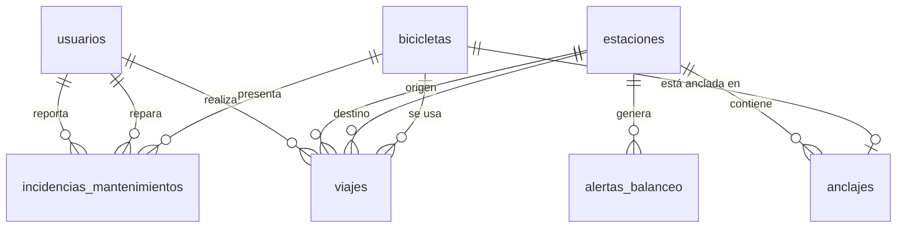

# Data Model: Modelo de datos compartido SI-16 (PostgreSQL + Redis)

**Branch**: `spec-001` | **Date**: 2026-10-20 | **Plan**: [plan.md](./plan.md) | **Decisiones**: [research.md](./research.md)

Modelo **único y compartido por las 8 especificaciones** (constitución, principio III). Fuente única de verdad: cualquier cambio requiere acuerdo del equipo antes de migrar. Las adiciones al esquema base pedido por el usuario están marcadas con `⚠ ADICIÓN` (R15 de research).

## Diagrama de entidades



## 1. Tabla `usuarios` (HU-01…HU-08, base de auth)

| Campo | Tipo | Restricciones | Origen |
|---|---|---|---|
| `id` | BIGSERIAL | PRIMARY KEY | pedido |
| `nombre` | TEXT | NOT NULL | pedido |
| `email` | TEXT | NOT NULL, UNIQUE sobre `lower(email)` (índice `ux_usuarios_email`) | pedido |
| `password_hash` | TEXT | NOT NULL | ⚠ ADICIÓN (R15: sesión iniciada) |
| `rol` | TEXT | NOT NULL DEFAULT 'usuario', CHECK IN ('usuario','operario_taller','operario_logistica','gestor') | pedido (enum derivado de R5) |
| `abono_activo` | BOOLEAN | NOT NULL DEFAULT FALSE | pedido |
| `fecha_vencimiento_abono` | DATE | NULL | pedido |
| `creado_en` | TIMESTAMPTZ | NOT NULL DEFAULT now() | ⚠ ADICIÓN (auditoría) |

```sql
CREATE TABLE usuarios (
  id                      BIGSERIAL PRIMARY KEY,
  nombre                  TEXT        NOT NULL,
  email                   TEXT        NOT NULL,
  password_hash           TEXT        NOT NULL,
  rol                     TEXT        NOT NULL DEFAULT 'usuario'
                          CHECK (rol IN ('usuario','operario_taller','operario_logistica','gestor')),
  abono_activo            BOOLEAN     NOT NULL DEFAULT FALSE,
  fecha_vencimiento_abono DATE,
  creado_en               TIMESTAMPTZ NOT NULL DEFAULT now()
);
-- Único sin distinguir mayúsculas: el login busca por lower(email).
CREATE UNIQUE INDEX ux_usuarios_email ON usuarios (lower(email));
```

- **Regla de negocio (const. I)** — *abono vigente*: es vigente ⇔ `abono_activo = TRUE AND fecha_vencimiento_abono >= CURRENT_DATE`. Si los campos son incoherentes (activo sin fecha o fecha pasada) se trata como **caducado** (decisión conservadora, R8/HU-02 FR-002).
- **Roles → permisos** (aplican los middlewares del backend; detalle en [contracts/openapi.yaml](./contracts/openapi.yaml)):
  - `usuario`: mapa (HU-01), desbloqueo (HU-02), devolución (HU-03), su historial (HU-04), reportar avería (HU-05).
  - `operario_taller`: panel de incidencias (HU-05) y fichas/taller (HU-06).
  - `operario_logistica`: panel de balanceo y traslados (HU-07).
  - `gestor`: analítica y exportación CSV (HU-08).

## 2. Tabla `estaciones` (HU-01, HU-05, HU-06, HU-07, HU-08)

| Campo | Tipo | Restricciones | Origen |
|---|---|---|---|
| `id` | BIGSERIAL | PRIMARY KEY | pedido |
| `nombre` | TEXT | NOT NULL, UNIQUE | pedido |
| `latitud` | NUMERIC(9,6) | NOT NULL, BETWEEN −90 y 90 | pedido |
| `longitud` | NUMERIC(9,6) | NOT NULL, BETWEEN −180 y 180 | pedido |
| `capacidad_total` | INTEGER | NOT NULL, CHECK > 0 | pedido |
| `estado` | TEXT | NOT NULL DEFAULT 'operativa', CHECK IN ('operativa','fuera_de_servicio') | ⚠ ADICIÓN (R15: HU-01 edge case + HU-07 FR "excluir sin capacidad computable") |

```sql
CREATE TABLE estaciones (
  id              BIGSERIAL PRIMARY KEY,
  nombre          TEXT NOT NULL UNIQUE,
  latitud         NUMERIC(9,6) NOT NULL CHECK (latitud  BETWEEN -90  AND 90),
  longitud        NUMERIC(9,6) NOT NULL CHECK (longitud BETWEEN -180 AND 180),
  capacidad_total INTEGER     NOT NULL CHECK (capacidad_total > 0),
  estado          TEXT        NOT NULL DEFAULT 'operativa'
                  CHECK (estado IN ('operativa','fuera_de_servicio'))
);
```

- Las estaciones `fuera_de_servicio` se muestran marcadas en el mapa (HU-01) y **se excluyen** del cálculo de ocupación y de la generación de alertas (HU-07).

## 3. Tabla `bicicletas` (HU-01, HU-02, HU-05, HU-06, HU-07)

| Campo | Tipo | Restricciones | Origen |
|---|---|---|---|
| `id` | BIGSERIAL | PRIMARY KEY | pedido |
| `codigo` | TEXT | NOT NULL, UNIQUE | pedido |
| `estado` | TEXT | NOT NULL DEFAULT 'disponible', CHECK IN ('disponible','en_uso','averiada','en_taller') | pedido |

```sql
CREATE TABLE bicicletas (
  id     BIGSERIAL PRIMARY KEY,
  codigo TEXT NOT NULL UNIQUE,
  estado TEXT NOT NULL DEFAULT 'disponible'
         CHECK (estado IN ('disponible','en_uso','averiada','en_taller'))
);
```

**Semántica de estados y máquina de transiciones** (todas las transiciones se aplican en el backend dentro de la transacción correspondientes; ninguna transición inválida es posible vía API):

| Estado | Significado operativo |
|---|---|
| `disponible` | Operativa. **Solo cuenta como disponible en una estación si está anclada** (R9). Sin anclaje = reparada/trasladada aún no ubicada → invisible en mapa (HU-06 FR-007). |
| `en_uso` | Desbloqueada con viaje activo (HU-02). |
| `averiada` | Reportada (HU-05); inhabilitada para alquiler y excluida de contadores, aunque ocupe un anclaje. |
| `en_taller` | En intervención de taller (HU-06). |

```text
disponible --desbloqueo exitoso (HU-02)--------------> en_uso
en_uso     --devolución en anclaje (HU-03)------------> disponible   (si no está averiada)
disponible --reporte de avería (HU-05)---------------> averiada
en_uso     --reporte de avería durante viaje (HU-05)-> averiada      (el viaje sigue en_curso; su devolución la deja anclada y averiada)
disponible --ingreso en taller (HU-06)---------------> en_taller
averiada   --ingreso en taller (HU-06)---------------> en_taller
averiada   --parte cerrado "operativa" sin taller---> disponible    (reparación directa)
en_taller  --parte cerrado marcando operativa (HU-06)-> disponible   (sin anclaje hasta confirmar ubicación)
```

Transición prohibida: `en_uso → en_taller/otra` sin pasar por devolución (garantizada porque la devolución es la única que desvincula viaje↔bicicleta).

## 4. Tabla `anclajes` (HU-01, HU-02, HU-03, HU-06, HU-07)

| Campo | Tipo | Restricciones | Origen |
|---|---|---|---|
| `id` | BIGSERIAL | PRIMARY KEY | pedido |
| `estacion_id` | BIGINT | NOT NULL, FK → estaciones(id) | pedido |
| `codigo_anclaje` | TEXT | NOT NULL, UNIQUE (conocido por el usuario, impreso en el anclaje) | pedido |
| `estado` | TEXT | NOT NULL DEFAULT 'libre', CHECK IN ('libre','ocupado','fuera_de_servicio') | pedido |
| `bicicleta_id` | BIGINT | NULL, FK → bicicletas(id), UNIQUE | pedido |

```sql
CREATE TABLE anclajes (
  id             BIGSERIAL PRIMARY KEY,
  estacion_id    BIGINT NOT NULL REFERENCES estaciones(id),
  codigo_anclaje TEXT   NOT NULL UNIQUE,
  estado         TEXT   NOT NULL DEFAULT 'libre'
                 CHECK (estado IN ('libre','ocupado','fuera_de_servicio')),
  bicicleta_id   BIGINT UNIQUE REFERENCES bicicletas(id),
  CHECK (estado <> 'ocupado' OR bicicleta_id IS NOT NULL),  -- ocupado ⇒ con bicicleta
  CHECK (bicicleta_id IS NULL OR estado <> 'libre')         -- libre ⇒ sin bicicleta
);
CREATE INDEX ix_anclajes_estacion ON anclajes(estacion_id);
```

- **Invariantes**: `UNIQUE (bicicleta_id)` ⇒ una bicicleta está en **como máximo un anclaje** (HU-03 FR-006). `fuera_de_servicio` admite o no bicicleta (anclaje retirado con bici dentro). Un anclaje `fuera_de_servicio` **no** cuenta como libre ni admite desbloqueos/devoluciones.

## 5. Tabla `viajes` (HU-02, HU-03, HU-04, HU-08)

| Campo | Tipo | Restricciones | Origen |
|---|---|---|---|
| `id` | BIGSERIAL | PRIMARY KEY | pedido |
| `usuario_id` | BIGINT | NOT NULL, FK → usuarios(id) | pedido |
| `bicicleta_id` | BIGINT | NOT NULL, FK → bicicletas(id) | pedido |
| `estacion_origen_id` | BIGINT | NOT NULL, FK → estaciones(id) | pedido |
| `estacion_destino_id` | BIGINT | NULL, FK → estaciones(id) | pedido |
| `fecha_inicio` | TIMESTAMPTZ | NOT NULL DEFAULT now() | pedido |
| `fecha_fin` | TIMESTAMPTZ | NULL | pedido |
| `duracion_minutos` | INTEGER | NULL, CHECK ≥ 0 | pedido (cálculo: `ceil(segundos/60)`, R8) |
| `coste_total` | NUMERIC(10,2) | NOT NULL DEFAULT 0, CHECK ≥ 0 | pedido |
| `estado` | TEXT | NOT NULL DEFAULT 'en_curso', CHECK IN ('en_curso','finalizado') | pedido |

```sql
CREATE TABLE viajes (
  id                  BIGSERIAL PRIMARY KEY,
  usuario_id          BIGINT      NOT NULL REFERENCES usuarios(id),
  bicicleta_id        BIGINT      NOT NULL REFERENCES bicicletas(id),
  estacion_origen_id  BIGINT      NOT NULL REFERENCES estaciones(id),
  estacion_destino_id BIGINT      REFERENCES estaciones(id),
  fecha_inicio        TIMESTAMPTZ NOT NULL DEFAULT now(),
  fecha_fin           TIMESTAMPTZ,
  duracion_minutos    INTEGER     CHECK (duracion_minutos IS NULL OR duracion_minutos >= 0),
  coste_total         NUMERIC(10,2) NOT NULL DEFAULT 0 CHECK (coste_total >= 0),
  estado              TEXT        NOT NULL DEFAULT 'en_curso'
                      CHECK (estado IN ('en_curso','finalizado')),
  CHECK (estado <> 'finalizado' OR (fecha_fin IS NOT NULL
                                    AND estacion_destino_id IS NOT NULL
                                    AND duracion_minutos IS NOT NULL)),
  CHECK (estado <> 'en_curso' OR (fecha_fin IS NULL AND estacion_destino_id IS NULL))
);
-- Reglas críticas garantizadas a nivel de BD (research R7):
CREATE UNIQUE INDEX ux_viajes_usuario_activo  ON viajes(usuario_id)  WHERE estado = 'en_curso';
CREATE UNIQUE INDEX ux_viajes_bicicleta_activa ON viajes(bicicleta_id) WHERE estado = 'en_curso';
CREATE INDEX ix_viajes_usuario_fecha ON viajes(usuario_id, fecha_inicio DESC);  -- HU-04
CREATE INDEX ix_viajes_fecha         ON viajes(fecha_inicio);                   -- HU-08
```

- **Máquina de estados**: `en_curso → finalizado` (única vez; HU-03 FR-006). Un viaje `en_curso` nunca tiene destino, fin ni duración; uno `finalizado` siempre los tiene todos.
- **Cálculo al cierre** (HU-03, R8, dentro de la transacción de devolución): `segundos = fecha_fin − fecha_inicio` (con `fecha_fin` validada, nunca negativa); `duracion_minutos = ceil(segundos/60)`; `coste_total = 0,00` si `segundos ≤ 1800`, si no `ceil((segundos−1800)/60) × TARIFA_MINUTO` (≥ 0).
- **Regla crítica (const. I)**: `ux_viajes_usuario_activo` hace imposible un segundo viaje activo por usuario — el intento simultáneo revienta por índice y la API responde 409 sin efectos parciales.

## 6. Tabla `incidencias_mantenimientos` (HU-05 + HU-06, reporte y parte unificados)

| Campo | Tipo | Restricciones | Origen |
|---|---|---|---|
| `id` | BIGSERIAL | PRIMARY KEY | pedido |
| `bicicleta_id` | BIGINT | NOT NULL, FK → bicicletas(id) | pedido |
| `usuario_reporta_id` | BIGINT | NULL, FK → usuarios(id) | pedido |
| `operario_id` | BIGINT | NULL, FK → usuarios(id) | pedido |
| `tipo_fallo` | TEXT | NOT NULL, CHECK IN ('frenos','cadena','neumatico','otro') | pedido |
| `descripcion_reporte` | TEXT | NOT NULL (obligatoria en el reporte — HU-05) | pedido |
| `piezas_sustituidas` | TEXT | NULL | pedido |
| `notas_taller` | TEXT | NULL | pedido |
| `fecha_reporte` | TIMESTAMPTZ | NOT NULL DEFAULT now() | pedido |
| `fecha_reparacion` | TIMESTAMPTZ | NULL | pedido |
| `estado` | TEXT | NOT NULL DEFAULT 'pendiente', CHECK IN ('pendiente','en_reparacion','resuelta') | pedido |

```sql
CREATE TABLE incidencias_mantenimientos (
  id                  BIGSERIAL PRIMARY KEY,
  bicicleta_id        BIGINT      NOT NULL REFERENCES bicicletas(id),
  usuario_reporta_id  BIGINT      REFERENCES usuarios(id),
  operario_id         BIGINT      REFERENCES usuarios(id),
  tipo_fallo          TEXT        NOT NULL
                      CHECK (tipo_fallo IN ('frenos','cadena','neumatico','otro')),
  descripcion_reporte TEXT        NOT NULL,
  piezas_sustituidas  TEXT,
  notas_taller        TEXT,
  fecha_reporte       TIMESTAMPTZ NOT NULL DEFAULT now(),
  fecha_reparacion    TIMESTAMPTZ,
  estado              TEXT        NOT NULL DEFAULT 'pendiente'
                      CHECK (estado IN ('pendiente','en_reparacion','resuelta')),
  CHECK (estado <> 'resuelta' OR (fecha_reparacion IS NOT NULL
                                  AND operario_id IS NOT NULL
                                  AND (piezas_sustituidas IS NOT NULL OR notas_taller IS NOT NULL)))
);
CREATE INDEX ix_incidencias_bicicleta ON incidencias_mantenimientos(bicicleta_id);
CREATE INDEX ix_incidencias_pendientes ON incidencias_mantenimientos(fecha_reporte) WHERE estado <> 'resuelta';  -- panel HU-05/HU-06
```

- **Flujo HU-05 (reporte)**: el usuario crea la fila con `usuario_reporta_id`, `tipo_fallo`, `descripcion_reporte` (obligatoria), `estado='pendiente'`, y en la misma transición la bicicleta pasa a `averiada` (idempotente: si ya está `averiada`, no se duplica el bloqueo — se responde con la incidencia existente). El reporte de una bicicleta `en_uso` también se admite (averiada con viaje en curso).
- **Flujo HU-06 (parte de taller)**: el operario cierra la reparación; **todas** las incidencias abiertas (`pendiente`/`en_reparacion`) de esa bicicleta pasan a `resuelta` con `operario_id`, `piezas_sustituidas`, `notas_taller`, `fecha_reparacion`, y la bicicleta pasa a `disponible` (sin anclaje). Mantenimiento **preventivo** (sin incidencia abierta): se INSERTA una fila con `tipo_fallo='otro'`, `descripcion_reporte='Mantenimiento preventivo'`, datos del parte y `estado='resuelta'` directamente. La **ubicación** en anclaje libre es una operación posterior (endpoint dedicado) que la hace visible en el mapa.
- **Máquina de estados**: `pendiente → en_reparacion → resuelta`; `pendiente → resuelta` (reparación directa). `resuelta` es final.

## 7. Tabla `alertas_balanceo` (HU-07)

| Campo | Tipo | Restricciones | Origen |
|---|---|---|---|
| `id` | BIGSERIAL | PRIMARY KEY | pedido |
| `estacion_id` | BIGINT | NOT NULL, FK → estaciones(id) | pedido |
| `tipo_alerta` | TEXT | NOT NULL, CHECK IN ('vacia_menos_10','llena_mas_90') | pedido |
| `porcentaje_ocupacion` | NUMERIC(5,2) | NOT NULL, CHECK BETWEEN 0 y 100 | pedido |
| `severidad` | TEXT | NOT NULL DEFAULT 'alta' (HU-07: prioridad alta) | pedido |
| `fecha_generacion` | TIMESTAMPTZ | NOT NULL DEFAULT now() | pedido |
| `resuelta` | BOOLEAN | NOT NULL DEFAULT FALSE | pedido |

```sql
CREATE TABLE alertas_balanceo (
  id                   BIGSERIAL PRIMARY KEY,
  estacion_id          BIGINT NOT NULL REFERENCES estaciones(id),
  tipo_alerta          TEXT   NOT NULL CHECK (tipo_alerta IN ('vacia_menos_10','llena_mas_90')),
  porcentaje_ocupacion NUMERIC(5,2) NOT NULL CHECK (porcentaje_ocupacion BETWEEN 0 AND 100),
  severidad            TEXT   NOT NULL DEFAULT 'alta',
  fecha_generacion     TIMESTAMPTZ NOT NULL DEFAULT now(),
  resuelta             BOOLEAN NOT NULL DEFAULT FALSE
);
-- Sin duplicados por estación y umbral (FR-003):
CREATE UNIQUE INDEX ux_alerta_abierta ON alertas_balanceo(estacion_id, tipo_alerta) WHERE NOT resuelta;
CREATE INDEX ix_alertas_abiertas ON alertas_balanceo(fecha_generacion DESC) WHERE NOT resuelta;  -- orden por urgencia
```

- **Umbrales estrictos** (HU-07): `vacia_menos_10` si ocupación `< 10 %`; `llena_mas_90` si `> 90 %`. Exactamente 10,00 % y 90,00 % **no** alertan. La ocupación solo se evalúa en estaciones `operativa`.
- **Creación/resolución** (R10): tras cada mutación de estación y en el barrido de 60 s: si se cruza un umbral y no existe alerta abierta de ese `(estacion_id, tipo_alerta)` → INSERT (el índice unique garantiza la unicidad); si la ocupación vuelve al rango `[10, 90]` → `resuelta = true` sobre la alerta abierta correspondiente.

## Modelo derivado: disponibilidad y ocupación (fuente única, R9)

Definiciones usadas por el backend, Redis, HU-01, HU-05, HU-06 y HU-07 de forma consistente:

```text
bicis_disponibles(e) = COUNT(anclajes de e con bicicleta.estado = 'disponible')
anclajes_libres(e)   = COUNT(anclajes de e con estado = 'libre')
ocupacion_pct(e)     = 100 * bicis_disponibles(e) / e.capacidad_total   (solo e.estado = 'operativa')
```

Invariante de cuadre por estación: `anclajes_libres + anclajes ocupados (por cualquier bicicleta, aunque esté averiada) + anclajes fuera_de_servicio = capacidad_total`. Una bicicleta `disponible` sin anclaje (reparada, HU-06) **no** pertenece a ninguna estación → no se cuenta en ningún sitio hasta confirmar su ubicación.

## Modelo en Redis (estado en vivo ≤ 30 s, constitución IV)

Detalle completo del contrato en [contracts/redis-state.md](./contracts/redis-state.md). Resumen:

| Clave | Tipo | Campos | TTL |
|---|---|---|---|
| `estacion:{id}:estado` | HASH | `bicis_disponibles`, `anclajes_libres`, `ocupacion_pct`, `estado`, `actualizado_en` (RFC3339 UTC) | 120 s (refrescado en cada escritura) |

- Escritura: (a) síncrona post-commit en cada mutación de estaciones/bicicletas/anclajes; (b) barrido de las ~60 estaciones cada 10 s (worker `refresco_estado`) → peor caso extremo a extremo ≈ 28 s < 30 s (R16). Anclajes con bicicleta averiada no suman en ningún contador: `bicis_disponibles + anclajes_libres ≤ capacidad_total` (R19).
- Lectura: `GET /estaciones` sirve el HASH; si la clave falta/expiró (parada del worker), se recalcula desde PostgreSQL y se repuebla (FR-005: nunca datos sin expiración/marca de tiempo).

## Reglas de negocio críticas (constitución I) → dónde se garantizan

| Regla | Capa de servicio (Go) | Refuerzo en BD | Prueba (quickstart) |
|---|---|---|---|
| Abono vigente para desbloquear | `services/alquiler` valida en transacción → 403 con causa | — (lógica de negocio) | S2, T1 |
| Un solo viaje activo por usuario | `services/alquiler` SELECT FOR UPDATE | `ux_viajes_usuario_activo` | S2, T2 |
| 30 min gratuitos, cobra solo excedente | `services/devolucion` cálculo R8 | CHECKs de `viajes` | S3, T3 |
| Bloqueo inmediato por avería | `services/incidencia` + `services/alquiler` rechaza bicis no disponibles | CHECKs + estados | S5, T4 |
| Alertas <10 % / >90 % | worker `alertas` + hook post-commit | `ux_alerta_abierta` | S7, T5 |

## Estrategia de migración y seeds

- Migración inicial `0001_esquema_base.sql` (este documento, íntegro) aportada por spec-001; migraciones posteriores `000N_spec-00X_tema.sql` con ordinal acordado (R6, principio III).
- `backend/cmd/seed`: ~60 estaciones geolocalizadas realistas (incluida alguna `fuera_de_servicio` y algunas en extremos de ocupación), anclajes = `capacidad_total` por estación, flota de bicicletas (algunas `averiada`), usuarios de prueba de **todos los roles** y con/without abono vigente; útil para los escenarios S1–S8 del [quickstart.md](./quickstart.md).
